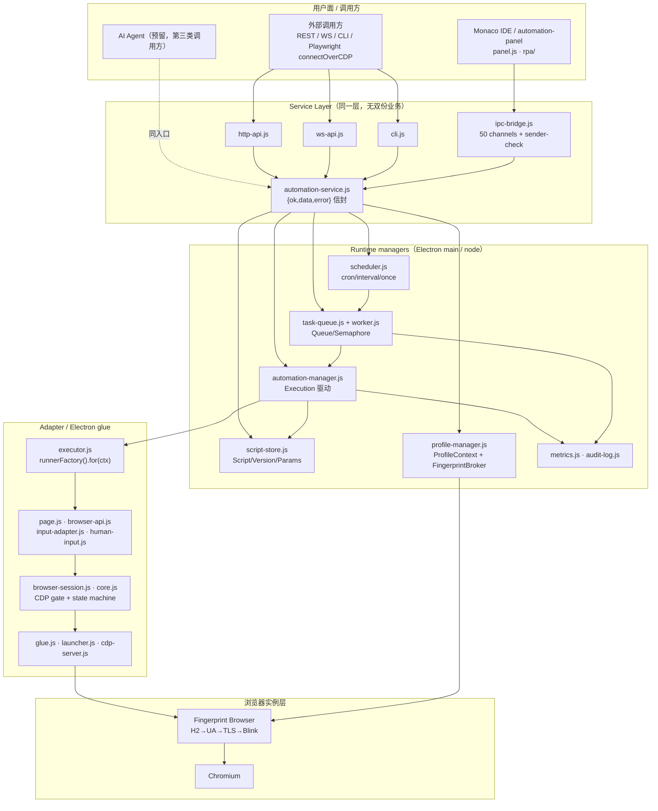
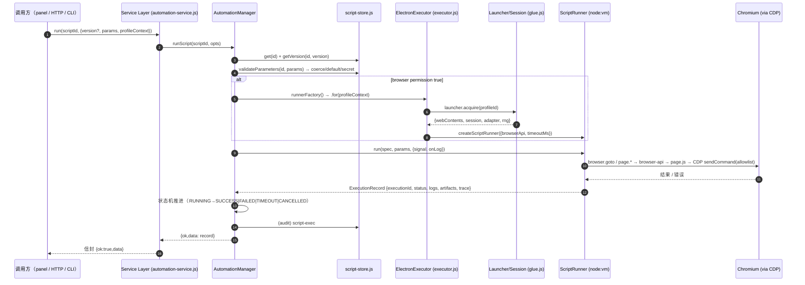
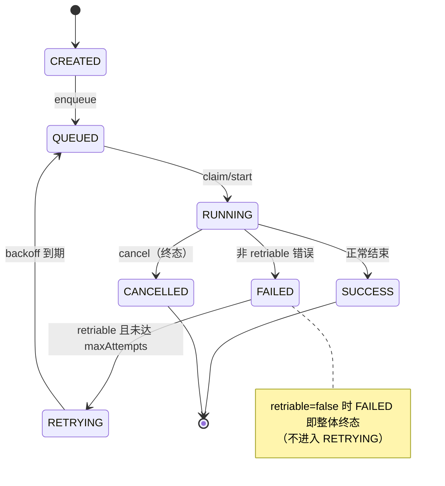

# 05 · 系统架构（System Architecture）

> 性质：研究交付件。**整合/改写**既有已核验设计（`docs/automation/`），非另立新系统。
> 口径：每节区分「目标（target）」与「现状（as-built）」。现状证据均带精确路径，未读码不写。
> 上游：[00-executive-summary.md](./00-executive-summary.md)；待决项：[11-open-questions.md](./11-open-questions.md)。
> 相关：[../automation/architecture.md](../automation/architecture.md)（目标设计）、[../automation/current-architecture.md](../automation/current-architecture.md)（2026-09-24 现状快照）、[../automation/automation-gap-analysis.md](../automation/automation-gap-analysis.md)（缺口/阶段/状态机）。

---

## 1. 目标与范围

| 项 | 内容 |
|---|---|
| 目标 | 为 Electron 指纹浏览器提供一套**共享 Automation Runtime**：脚本 / RPA→AST / AI Agent 三类调用方，经同一 SDK → Adapter → 浏览器实例层执行，带调度、队列、并发、重试、审计、可观测性。 |
| 范围 | Script 管理中心、脚本编辑器、模板库、执行引擎、浏览器实例连接管理、任务调度、并发与资源管理、日志与错误追踪、版本管理、批量任务、权限与安全、执行历史、配置绑定、导入导出、可选可视化编排。 |
| 非目标 | 不新建 Browser/Profile/IPC manager 抽象（两 Client 已有实现，见 `current-architecture.md` §24）；不 naive 合并 Client/MClient 会话模型；不建插件市场（marketplace 字段仅 reserved）。 |
| 成功标准 | 任一 execution 3 跳内定位 version + params 快照 + worker；secret 不可 grep；crash 恢复每步有审计行；100k executions / 1M logs 下列表 <500ms（gap 附录 C）。 |

---

## 2. 与现有 Electron 指纹内核的解耦原则

1. **脚本只见 SDK**：脚本禁止 `require`/`import` Electron、Node 内建（`fs`/`child_process`/`net`/`dgram`）、裸 `process`、裸 CDP 句柄；由 `automation/runtime/script-runner.js` 的 `node:vm` 沙箱强制（`codeGeneration:{strings:false, wasm:false}`，仅注入白名单全局）。
2. **指纹变更唯一入口 `FingerprintBroker`**：任何 `setFingerprintConfig` / `setSSLConfig` / `setUserAgent` / `fromPartition(http2Profile)` 直调一律禁止；实装于 `automation/runtime/profile-manager.js` 的 `fingerprintUpdate` / `fingerprintRotate`（五道门）。
3. **debugger 常驻 main-only**：CDP 经 `webContents.debugger`（`automation/runtime/browser-session.js` + `core.js:gateCdpMethod`），永不桥接 renderer/preload。
4. **Renderer 只做 UI**：preload 为 invoke-only（`Client/preload.js`），脚本执行、debugger attach、指纹切换永不进 renderer。
5. **复用已验证的指纹路径**：`fpSplitConfig` 分流、TLS 9 键 / H2 3 键、mini-browser 顺序 **H2→UA→TLS→Blink**、profile 生命周期；partition 一律 `persist:auto-{profileId}`（`profile-manager.js:132`）。
6. **入口门控**：IPC 走 `ipc-bridge.js` 的 sender-check + channel allowlist；REST/WS 走 loopback + Host/Origin + Bearer 三重门；`--remote-debugging-port` 生产缺席（ADR-3）。

---

## 3. 分层架构（目标）与 as-built 现实

目标分层（`architecture.md` §0/§1）：

```
用户面            Monaco IDE / automation-panel（RPA builder）
   │
Service Layer     REST(http-api.js) / WS(ws-api.js) / CLI(cli.js) / IPC(ipc-bridge.js)
   │              —— 同一层，全部经 automation-service.js（无双份业务）
Runtime managers  Automation / Script / Task / Profile / Session
   │              （automation-manager / script-store / task-queue+worker / profile-manager / browser-session）
Adapter           Playwright / CDP(webContents.debugger) / Electron 原生
   │
浏览器实例层      BrowserSession → ProfileContext → Fingerprint Browser → Chromium
```

**as-built 现实（必须显式声明，勿把设计当已实现）**：

| 目标表述 | 实际实现 |
|---|---|
| Runtime 在 main 进程 | ✅ 成立：打包/默认运行由 `Client/main.js:905` 一行 `attachAutomation(...)` 在 **Electron main** 内建栈；独立无头模式见 `automation/bin/serve.js`（node 进程，**仅开发者/CI/自托管服务端模式，不随客户分发**，见 [16](16-zero-runtime-distribution-constraints.md)）。 |
| 脚本执行 | ✅ `node:vm`（`script-runner.js:4,437`），**非**独立 worker 进程/utilityProcess。 |
| 「Worker」 | ✅ **同进程轮询循环**（`automation/runtime/worker.js:createWorker`；`heartbeatMs=5000`、`taskTimeoutMs=60000`），非远程执行器。 |
| 存储 | ⚠️ **JSON 文件**（`script-store.js`、`profiles.json`、`automation-store.json`、audit JSONL），**非 SQLite**。`database.md` 的 12 表为**目标设计**。 |
| Adapter 三后端 | ⚠️ 实际默认 **CDP over `webContents.debugger` + Electron 原生**；Playwright `connectOverCDP` 只做外部接入（`electron/cdp-server.js`）；Puppeteer **未实现**。 |
| 用户面 Monaco | ⚠️ 面板默认 **textarea 编辑器**；Monaco 为**惰性可选**（`Client/renderer/automation-panel/panel.js:450` `ensureMonaco()` 探 `vendor/monaco/...`，缺席即回退）。`automation.d.ts` 为 Monaco 补全的类型面（源：`script-sdk.md` §5）。 |

---

## 4. 模块边界与职责表

> 状态口径：**已建**=代码落地；**部分**=接口/子集落地；**目标**=仅设计未建。

| 模块 | 目标职责 | as-built 实现（文件 / 导出） | 状态 |
|---|---|---|---|
| Script 管理中心 | Script CRUD、参数 schema 校验、软删除 | `runtime/script-store.js` `createScriptStore`（create/get/list/update/remove/validateParameters）；`runtime/automation-service.js` `scripts.*`；IPC `automation:scripts:*` | 已建 |
| 脚本编辑器 | 编写/校验/保存脚本、Monaco 补全 | `Client/renderer/automation-panel/panel.js`（textarea + `ensureMonaco` 惰性）；类型面 `automation/automation.d.ts` | 部分 |
| 模板库 | 一键克隆、参数预填 | `runtime/script-templates.js`（`TEMPLATES` / `installTemplates`）；`service.templates.list/install`；IPC `automation:templates:*` | 已建 |
| 依赖管理 | 脚本依赖解析/锁定 | —（store 无依赖图；设计未展开） | 目标 |
| 自定义 SDK | 稳定脚本 API 面（权限面） | `automation/automation.d.ts`（ambient 声明，Monaco `addExtraLib`）；运行时注入见 `script-runner.js` | 已建 |
| 执行引擎 | 建 Execution、跑脚本、状态机、取消 | `runtime/script-runner.js` `createScriptRunner`；`runtime/automation-manager.js` `createAutomationManager`（runScript / runScriptCancellable / cancel） | 已建 |
| 浏览器实例连接管理器 | Session 状态机、CDP attach、崩溃恢复、外部接入 | `runtime/core.js`（状态机 + `gateCdpMethod`）、`runtime/browser-session.js`；`electron/glue.js`（`createElectronSession`/`restartSession`）、`electron/launcher.js`、`electron/cdp-server.js` | 部分（真实 attach/relaunch 见 §8 缺口） |
| 任务调度器 | cron/interval/once、扇出、暂停恢复 | `runtime/scheduler.js` `createScheduler`（add/pause/resume/triggerNow/tick）；IPC `automation:schedules:*` | 已建 |
| 并发与资源管理器 | Task concurrency、Worker semaphore、同身份串行 | `runtime/task-queue.js`（`TRANSITIONS`、claim/并发）；`runtime/worker.js`（semaphore、同 profile 串行）；`automation-manager.js` `maxConcurrent=5`；`profile-manager.js` `bulkStart(concurrency=5)` | 已建 |
| 日志与错误追踪 | 三级日志、error taxonomy、failure forensics | `script-runner.js`（logs + 9 错误类 + `buildTrace`）；`runtime/audit-log.js`；`runtime/metrics.js`；`electron/wire.js` live-log | 已建 |
| 版本管理 | 不可变版本、草稿→发布、回滚 | `script-store.js` `addVersion`/`getVersion`（newest-first）；`automation.d.ts` `ScriptMetadata.versions`；DB `script_versions` 为目标 | 部分 |
| 批量任务 | Task 展开 N Item、fan-out、重试 | `automation-service.js` `createTaskExecutor`；`task-queue.js` enqueue；`scheduler.js` 扇出；`profile-manager.js` bulkStart | 已建 |
| 权限与安全 | capability、trust、RBAC、围栏、sender-check | `script-store.js`（`CAPS`/`DEFAULT_PERMISSIONS`/`trust`）、`script-runner.js`（`capAllowed`/`denyProxy`/`trustResolver`）、`http-api.js`（RBAC/JWT）、`ipc-bridge.js`、`electron/browser-api.js`（fence） | 已建 |
| 执行历史 | 执行记录/日志查询、指标 | `automation-manager.js` listExecutions/getExecution/getLogs；IPC `automation:executions:*`；`metrics.js` | 已建 |
| 配置绑定 | typed params、secret 引用、默认值 | `script-store.js` `validateParameters`/`coerceParam`（9 型）；`automation.d.ts` `ScriptParameter` | 已建 |
| 导入导出 | fp-script 包往返 | `script-store.js` `exportScript`/`importScript`（`format:'fp-script', v:1`）；IPC/HTTP export/import | 已建 |
| 可选可视化编排（RPA） | 录制→AST→同一 Runtime | `runtime/rpa-ast.js`、`runtime/rpa-recorder.js`、`electron/recorder.js`、`electron/recorder-controller.js`；面板 `automation-panel/rpa/` | 部分 |

---

## 5. 架构图（Mermaid）



---

## 6. 时序图：一次脚本执行的端到端链路



---

## 7. 状态机图：Execution 7 态

> 分层口径（`task.md` §2、`database.md` §5）：本图是 **Execution 层 7 态**，`SUCCESS` 为 canonical。队列层另有 12 态（`task.md` §3），Task/Item 汇总层小写 6 态（`database.md` §7–§8）。三层各管各的。



补充：`script-runner.js` 的 `ExecutionStatus` 另含 `TIMEOUT` / `CRASHED`（失败类终态）；`automation.d.ts` 的 `ExecutionStatus` 为 `'RUNNING' | 'SUCCESS' | 'FAILED' | 'TIMEOUT' | 'CANCELLED' | 'CRASHED'`。Task 层 retriable 分类见 [06-script-sdk-specification.md](./06-script-sdk-specification.md) §4。

---

## 8. 与现有浏览器的集成点

### 8.1 Client/main.js 接线（单点）

`Client/main.js:905`（`try/catch` 包裹，packaged 无 `../automation` 时不阻断启动）：

```js
try {
  require('../automation/electron/wire').attachAutomation({
    ipcMain,
    service: require('../automation/electron/wire').buildLocalService({
      file: require('path').join(__dirname, 'automation-store.json'),
      audit: (...a) => { try { console.debug('[automation-audit]', JSON.stringify(a)); } catch (_) {} },
    }),
    allowedSenders: [{ urlPrefix: 'file://' }],
    push: (...a) => mainWindow.webContents.send('automation:event', ...a),
  });
} catch (_) {}
```

- `wire.js` 的 `buildLocalStack` 在 main 内组装 `store / manager / queue / scheduler / profileManager / auditLog / service`；`attachAutomation` 注册 IPC 并把 runner 的 `onLog` 桥为 `automation:event` 推送。
- 独立无头入口：`automation/bin/serve.js`（HTTP + WS + worker + scheduler tick，可另起 CDP-WS）。

### 8.2 preload facade

`Client/preload.js`：`contextBridge.exposeInMainWorld('api', { ... automationApi })` 且 `exposeInMainWorld('automationApi', ...)`。`autoCall(ch, ...args)` 解 `{ok,data,error}` 信封，错误抛给面板 banner；`onAutomationEvent(cb)` 订阅 `automation:event`（live 日志）。面板读 `window.automationApi`。

### 8.3 IPC 50 通道（`runtime/ipc-bridge.js` `CHANNEL_MAP`）

| 组 | 数量 | 通道 |
|---|---|---|
| status | 1 | `automation:status` |
| scripts | 9 | list / get / create / update / remove / saveVersion / export / import / validateParams |
| trust | 2 | `automation:scripts:trust` / `:untrust` |
| run | 1 | `automation:run` |
| executions | 4 | get / list / logs / cancel |
| tasks | 7 | enqueue / list / get / cancel / pause / resume / retry |
| schedules | 6 | add / list / pause / resume / trigger / remove |
| profiles | 11 | list / get / create / update / remove / start / stop / status / bulkStart / fingerprintUpdate / fingerprintRotate |
| templates | 2 | list / install |
| recorder | 4 | start / drain / stop / state |
| audit | 2 | query / stats |
| metrics | 1 | `automation:metrics` |

门控：`ALLOWED_CHANNELS` 冻结；`isSenderAllowed` 仅接受 `type ∈ {window, webContents}`（webview 恒拒）且 URL 前缀匹配（默认 `file://` / `http://127.0.0.1` / `http://localhost`）；审计只记 `channel/status/code`，**不记 args**。

### 8.4 profile-manager 与 FingerprintBroker

`runtime/profile-manager.js`：JSON 文件存储；`partition = 'persist:auto-' + id`（构造即持久，杜绝内存态）；生命周期 `stopped/starting/running/stopping/error`；`RESTART_FIELDS = ['fingerprint','proxy','partition']`（running 改 → 409）。

FingerprintBroker 五道门（`fingerprintUpdate` / `fingerprintRotate`）：

1. **permission**：bearer 必检（`fpBroker.token`，常数时间比较），失败 `UNAUTHORIZED`。
2. **validate**：按 TLS 9 键 / H2 3 键 / 其余=blink 分流；`fpValidate` hook 校验（未知键拒）。
3. **lifecycle**：running → `CONFLICT`；H2 键遇已冻结 partition（`meta.everStarted`）→ 诚实 `h2Error`，不静默丢弃。
4. **restart**：`restartRequired` 标志；`fingerprintRotate` 对 running 执行 stop→update→start 一键编排。
5. **log**：audit 行含 `keyHash`，**永不记载体原文**。

原子性：校验先于任何变更，失败不留半切换身份。

---

## 9. 与 `docs/automation` 的关系（delta）

> 三类：**新增**（既有文档未描述、本轮新增/实装）、**修改**（既有设计被现实改写）、**废弃**（旧表述/设计作废）。

### 9.1 新增

| 条目 | 对应文件 |
|---|---|
| as-built 实现树（runtime/electron/bin） | `automation/runtime/*.js`、`automation/electron/*.js`、`automation/bin/{serve,browser-cli}.js` |
| IPC bridge 50 通道 + preload facade | `automation/runtime/ipc-bridge.js`、`Client/preload.js` |
| HTTP/WS/CLI 同一 Service Layer | `runtime/http-api.js`、`runtime/ws-api.js`、`runtime/cli.js`、`runtime/automation-service.js` |
| FingerprintBroker 实装（五道门 + rotate） | `runtime/profile-manager.js`（`fingerprintUpdate`/`fingerprintRotate`） |
| RPA 录制→AST | `runtime/rpa-ast.js`、`runtime/rpa-recorder.js`、`electron/recorder.js`、`electron/recorder-controller.js` |
| 可观测性实装（metrics + audit ring/JSONL） | `runtime/metrics.js`、`runtime/audit-log.js` |
| 模板库 / 类人输入 / 种子 RNG / 输入适配 | `runtime/script-templates.js`、`runtime/human-input.js`、`runtime/seeded-rng.js`、`runtime/input-adapter.js` |
| 面板嵌入（与 `#fp-panel` 互斥共用列） | `Client/renderer/automation-panel/panel.js`、`Client/renderer/index.html:153,166` |
| CDP-WS 外部接入 | `electron/cdp-server.js`、`runtime/cdp-ws.js` |

### 9.2 修改

| 条目 | 既有表述 | 现实 |
|---|---|---|
| 持久化 | `database.md` SQLite 12 表 | JSON 文件（`script-store.js` / `profiles.json` / `automation-store.json` / audit JSONL） |
| 现状基线 | `current-architecture.md`（2026-09-24） | 快照未含 `automation/`；其 IPC sender-check 与导航守卫「缺失」结论**已过时**（现均已补齐，见该文 §8/§9/§22 的删除线修订） |
| Worker remote | `worker.md` §1 remote 只留接口 | 未实现；进程级自愈（步 6 relaunch/reattach）未做 |
| Scheduler | `scheduler.md` | `overlap`/多时区 reserved；无跨 Schedule DAG |
| 队列升级 | `task.md` §4 fail-fast 现状 | `automation-manager.js` 的 `maxConcurrent` throw 为 Phase 4 前形态；认领/重试/超时移交 `task-queue.js` |
| Execution 状态 | `database.md` §5 7 态 | `script-runner.js` 另有 `TIMEOUT`/`CRASHED`；`SUCCESS` canonical |

### 9.3 废弃

| 条目 | 说明 | 出处 |
|---|---|---|
| 「`RUNNING→PAUSED` 不合法」 | 已作废：迁移合法，是否中断由 `interrupt` 决定 | `task.md` §3.1 脚注 |
| Puppeteer `connect` | 接口预留，无调用方，不实现 | `runtime.md` §2.1 |
| `--remote-debugging-port` 生产路径 | ADR-3 默认缺席；启用即全 CDP 无鉴权面 | `runtime.md` §2.1 / `architecture.md` ADR-3 |
| Env 通道 `FP_CONFIG*` 默认开启 | ADR-5 默认关闭（任意进程可写 env = 注入面） | `architecture.md` ADR-5 |
| `wc.debugger` 无鉴权直调 | 收敛为 `gateCdpMethod` allowlist | `core.js` / `runtime.md` §3 |
| marketplace 逻辑 | 字段 reserved，不建市场 | `database.md` §1/§4 |

---

## 10. 引用

- 目标设计：[../automation/architecture.md](../automation/architecture.md)
- 现状快照：[../automation/current-architecture.md](../automation/current-architecture.md)
- 缺口/阶段/状态机：[../automation/automation-gap-analysis.md](../automation/automation-gap-analysis.md)
- 运行时：[../automation/runtime.md](../automation/runtime.md)；Worker：[../automation/worker.md](../automation/worker.md)；Task：[../automation/task.md](../automation/task.md)；Scheduler：[../automation/scheduler.md](../automation/scheduler.md)
- API：[../automation/api.md](../automation/api.md)；DB（目标）：[../automation/database.md](../automation/database.md)
- SDK 规格（本包）：[06-script-sdk-specification.md](./06-script-sdk-specification.md)
- 执行摘要：[00-executive-summary.md](./00-executive-summary.md)；待决项：[11-open-questions.md](./11-open-questions.md)
