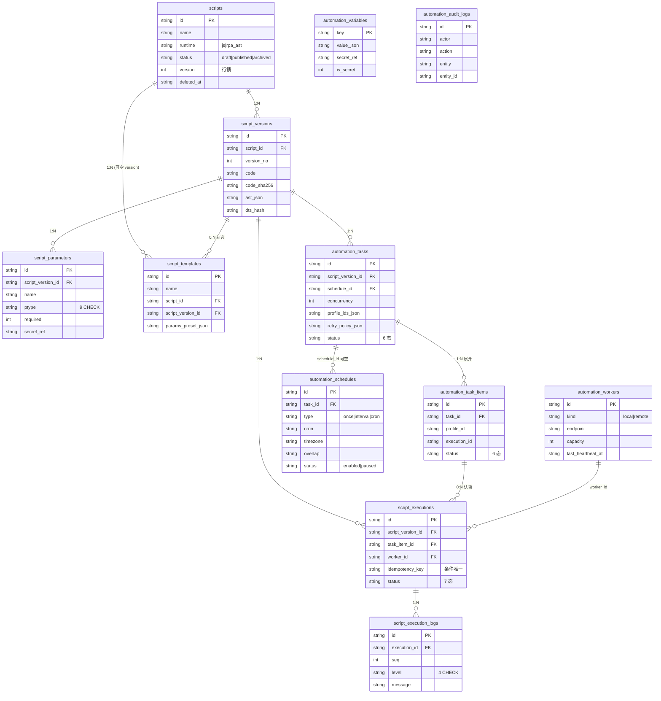

# 07 · 数据模型与 API（Data Model & API）

> 性质：research+design 合并稿，**以仓库实读源码为准**（`automation/runtime/*.js`），并**整合/适配**既有 `docs/automation/` 设计语料。
> 核心不等式：**Script ≠ Task ≠ Execution**——Script 是可复用可版本化程序；Task（AutomationTask）= Script × Profile 集合的执行计划；Execution = 一次运行实例。
> 一句话现状：**12 张 SQLite 表是「设计（未实现）」**；as-built 实际存储是 `script-store.js` 的单文件 JSON（`Client/automation-store.json`，或 `FP_AUTOMATION_STORE`）。
> 姊妹文档：本包编号导航见 §0；数据模型 delta 见 §7；运行/安全 delta 见 `08-runtime-security-and-reliability.md` §6。

---

## 0. 文档集导航（00–11）

本包编号 00–11，本文件为 **07**。已落盘的姊妹文档（相对链接）：

| 编号 | 文档 | 说明 |
|---|---|---|
| 00 | [00-executive-summary.md](./00-executive-summary.md) | 执行摘要 |
| 01 | [01-source-catalog.md](./01-source-catalog.md) | 8 款竞品官方资料索引 |
| 02 | [02-competitor-matrix.md](./02-competitor-matrix.md) | 竞品功能矩阵 |
| 03 | [03-competitor-technical-analysis.md](./03-competitor-technical-analysis.md) | 机制分析 + 证据等级 |
| 04 | [04-automation-technology-selection.md](./04-automation-technology-selection.md) | 技术选型 |
| 05 | [05-system-architecture.md](./05-system-architecture.md) | 系统架构（目标 vs 现状） |
| 06 | [06-script-sdk-specification.md](./06-script-sdk-specification.md) | Script SDK 规格 |
| **07** | **`07-data-model-and-api.md`** | **本文件：数据实体 + 三层 API** |
| **08** | [08-runtime-security-and-reliability.md](./08-runtime-security-and-reliability.md) | 运行可靠性 + 执行安全 |
| 09 | [09-test-and-acceptance-plan.md](./09-test-and-acceptance-plan.md) | 测试与验收计划 |
| 10 | [10-implementation-roadmap.md](./10-implementation-roadmap.md) | 实施路线图 |
| 11 | [11-open-questions.md](./11-open-questions.md) | 待决问题 |

> 上游：[00-executive-summary.md](./00-executive-summary.md)；架构：[05-system-architecture.md](./05-system-architecture.md)；待决项：[11-open-questions.md](./11-open-questions.md)。

---

## 1. 存储现状 vs 设计（先读这一节，避免把设计当事实）

| 维度 | as-built（实读源码） | 设计（`docs/automation/database.md`，**未实现**） |
|---|---|---|
| 存储介质 | 单 JSON 文件：`Client/automation-store.json`（`Client/main.js:905` 接线）；CLI/serve 用 `FP_AUTOMATION_STORE`，缺省 `os.tmpdir()/fp-automation-store.json`（`bin/serve.js:156`、`bin/browser-cli.js:20`） | 单文件 `automation.db`，WAL（`journal_mode=WAL; synchronous=NORMAL; foreign_keys=ON`） |
| 写盘 | `script-store.js` tmp+rename 原子替换（`script-store.js:143-150`）；**无锁**（同 store 只允许单写者，见 `cli.md` §5） | 事务 + 行级乐观锁 `version` |
| 实体落点 | Script 及其 versions/parameters 全内嵌于一个 JSON 文档 | 12 张规范化表 |
| 表数量 | 0 | 12 |
| 状态口径 | runner 6 态 / queue 12 态（内存） | Execution 7 态 / Task 6 态（CHECK 约束） |
| 日志 | runner `record.logs` 内存数组（`MAX_LOGS=1000`，超限丢新行）；audit 内存 ring + 可选 JSONL | `script_execution_logs` 表 + `(execution_id, seq)` 索引 |
| 迁移 | 无 | `SCHEMA_VERSION` 存 `automation_variables`；`scripts/import-profiles.js` 幂等迁移 |

**升级触发条件（ponytail ceiling）**：`script-store.js:1` 注释明写「swap to SQLite at database.md when 10k scripts land」。在此之前 JSON 足够；不要预建表。

### 1.1 设计的 12 张表 → 实体映射

| # | 设计表 | 状态 | 映射实体 | 备注 |
|---|---|---|---|---|
| 1 | `scripts` | 设计未实现 | Script | 脚本本体 |
| 2 | `script_versions` | 设计未实现 | ScriptVersion | 不可变快照 |
| 3 | `script_parameters` | 设计未实现 | ScriptParameter | as-built 内嵌于 Script |
| 4 | `script_templates` | 设计未实现 | ScriptTemplate | as-built 是代码常量 |
| 5 | `script_executions` | 设计未实现 | ScriptExecution | 运行实例 |
| 6 | `script_execution_logs` | 设计未实现 | ExecutionLog | 执行级日志 |
| 7 | `automation_tasks` | 设计未实现 | AutomationTask | 执行计划 |
| 8 | `automation_task_items` | 设计未实现 | AutomationTask（展开子项） | 单 profile 认领单元 |
| 9 | `automation_schedules` | 设计未实现 | AutomationSchedule | cron 调度 |
| 10 | `automation_workers` | 设计未实现 | （运行时概念 Worker） | as-built `worker.js` 无表行 |
| 11 | `automation_variables` | 设计未实现 | ScriptEnvironment | KV/系统配置 |
| 12 | `automation_audit_logs` | 设计未实现 | AuditLog | 审计，append-only |

**额外（不在 12 表内）实体**：ScriptProject、ScriptDependency、BrowserProfileBinding、ExecutionArtifact、ScriptPermission。见 §2 各自「映射」行。

---

## 2. 实体字典

> 约定：类型用 TS 记法；「必填」指创建时必需；「默认」为 as-built 代码默认；「设计列」指 `database.md` 对应表列；「映射」标注是否落在 12 表内。

### 2.1 Script（脚本本体）

as-built 形状（`script-store.js:create` `:180-195`）：

| 字段 | 类型 | 必填 | 默认 | 约束 | 关联/索引 |
|---|---|---|---|---|---|
| `id` | `string`(uuid) | 系统 | `crypto.randomUUID()` | — | PK（设计 `scripts.id`） |
| `name` | `string` | 是 | — | 非空、trim 后非空、`<=120` 字符 | 设计：`UNIQUE(name) WHERE deleted_at IS NULL` |
| `author` | `string` | 否 | `undefined` | — | 设计列 `marketplace_author`（reserved） |
| `description` | `string` | 否 | `undefined` | — | 设计列 `description` |
| `category` | `string` | 否 | `undefined` | — | 无独立列（内嵌） |
| `entry` | `string` | 否 | `'main.js'` | 非空字符串 | 设计列 `entry`（默认 `'main'`） |
| `permissions` | `object` | 否 | `DEFAULT_PERMISSIONS` | 键 ∈ `CAPS`（6），值 boolean | 内嵌 JSON；见 §2.13 |
| `parameters` | `ScriptParameter[]` | 否 | `[]` | `validateParameters` | 设计：拆 `script_parameters` 表 |
| `trusted` | `boolean` | 否 | `false` | **仅 service `trust()` 可置 true**；create/update/import 传 `true` 直接拒绝 | 内嵌；见 §2.13 |
| `trustedAt` | `string`(ISO) | 否 | — | `trust()` 写 | — |
| `trustedVersion` | `string` | 否 | — | `trust()` 写（钉最新版本） | — |
| `trustedBy` | `string` | 否 | — | `trust({actor})` 写 | — |
| `versions` | `{version,code,createdAt}[]` | 自动 | `[]` | **newest-first**（`unshift`） | 设计：拆 `script_versions` 表 |
| `createdAt` | `string`(ISO) | 系统 | `now()` | — | 设计列 `created_at` |
| `updatedAt` | `string`(ISO) | 系统 | `now()` | — | 设计列 `updated_at` |
| `deletedAt` | `string`(ISO) | 否 | — | 软删；`find()` 过滤 `!deletedAt` | 设计列 `deleted_at` |

**生命周期**：`create → update(meta) / addVersion / trust|untrust / remove(软删)`。
**可更新 meta 字段**（`META_FIELDS`，`script-store.js:14`）：`name`、`description`、`category`、`entry`、`permissions`、`parameters`、`trusted`——**`author` 故意不可更新**；`trusted` 在 `update` 中被二次拦截（`script-store.js:226,229`）。
**映射**：→ `scripts`（设计未实现）。

### 2.2 ScriptVersion（不可变版本快照）

as-built（`script-store.js:addVersion` `:289-307`、`getVersion` `:309-317`）：

| 字段 | 类型 | 必填 | 默认 | 约束 | 关联 |
|---|---|---|---|---|---|
| `version` | `string` | 否 | `nextVersion()` | 同脚本内唯一；semver patch 自增（`1.0.0→1.0.1`），非 semver 用 `v{n}` | 设计 `script_versions.version_no`（INTEGER） |
| `code` | `string` | 是 | — | trim 后非空 | 设计 `code`（NOT NULL） |
| `createdAt` | `string`(ISO) | 系统 | `now()` | — | 设计 `created_at` |

**版本自增规则**（`nextVersion`）：最新是 `x.y.z` → `x.y.(z+1)`；否则 `v{count+1}`；首版 `1.0.0`。
**trust 失效**：`addVersion` 一旦成功，`trusted` 立即回 `false` 并清 `trustedAt/trustedVersion/trustedBy`（签名按当前 latest code 校验，新码即失效）。
**设计列**（`database.md` §2）：`id`、`script_id` FK、`version_no INTEGER`、`code`、`code_sha256`、`ast_json`、`dts_hash`、`status(draft/published/deprecated)`、`version`(行锁)、时间戳、`deleted_at`。
**Delta**：as-built **无** `id/code_sha256/ast_json/dts_hash/status/行锁`；版本号是 semver 字符串而非序号。
**映射**：→ `script_versions`（设计未实现）。

### 2.3 ScriptParameter（typed params）

as-built（`script-store.js:validateParameters` `:32-51`、`coerceParam` `:71-120`）：

| 字段 | 类型 | 必填 | 默认 | 约束 |
|---|---|---|---|---|
| `name` | `string` | 是 | — | 非空；禁止保留字 `__proto__`/`constructor`/`prototype`；同脚本内唯一 |
| `type` | `ParamType`(9) | 是 | — | 见下 9 值 |
| `required` | `boolean` | 是 | — | 必须显式 boolean |
| `default` | `unknown` | 否 | — | 缺失且 required → 校验错误 |
| `options` | `string[]` | 条件 | — | **仅** `select`/`multi-select` 允许且非空；其他类型出现即报错 |
| `secret` | `boolean` | 否 | — | `true` 时值进 `secretNames` 集合，日志/错误栈双 scrub |

**`ParamType` 9 值**（canonical 大写 `JSON`）：`string` `number` `boolean` `select` `multi-select` `secret` `file` `textarea` `JSON`。
**coerce 规则**：string/secret/file/textarea→string；number→有限数（可解析字符串）；boolean→`true`/`'true'`；select→∈options；multi-select→数组且⊆options；JSON→对象或可解析 JSON 串。
**设计列**（`database.md` §3）：`id`、`script_version_id` FK、`name`、`ptype`(9 CHECK)、`required` INTEGER、`default_json`、`options_json`、`secret_ref`、`version`、时间戳。
**Delta**：as-built 挂在 **Script**（非 Version）；**无 `secret_ref`**（不存 vault，secret 值运行期脱敏，不入库）。
**映射**：→ `script_parameters`（设计未实现）。

### 2.4 ScriptTemplate（模板）

as-built（`script-templates.js`）：**代码内常量** `TEMPLATES`（11 个内置），非表。

| 字段 | 类型 | 必填 | 说明 |
|---|---|---|---|
| `key` | `string` | 是 | 模板标识（如 `open-website`、`login`） |
| `name` | `string` | 是 | 展示名 |
| `description` | `string` | 是 | — |
| `category` | `string` | 是 | `navigation`/`auth`/`forms`/`data`/`utility`/`monitoring`/`files`/`workflow` |
| `permissions` | `object` | 是 | 同 Script.permissions |
| `parameters` | `ScriptParameter[]` | 是 | — |
| `code` | `string` | 是 | async main body（仅 SDK 全局） |

**安装语义**（`installTemplates(store,{prefix='[Template] '})`）：按 `name` 幂等（已存在则 `skipped`）；`create` + `addVersion` 克隆为真 Script；返回 `{installed, skipped}`。
**设计列**（`database.md` §4）：`id`、`name`、`script_id` FK、`script_version_id` FK（可空）、`params_preset_json`、`doc_md`、`marketplace_*` 4 列、`status`、`version`、时间戳。
**Delta**：as-built 无 DB 行、无 `params_preset_json`/`doc_md`/`marketplace_*`；`script_version_id` 钉选概念未落地（安装即最新码）。
**映射**：→ `script_templates`（设计未实现）。

### 2.5 ScriptExecution（执行实例）

as-built 由 **runner record**（`script-runner.js:321-336`）与 **manager record**（`automation-manager.js:32-47`）合成：

| 字段 | 类型 | 必填 | 默认 | 约束 | 关联 |
|---|---|---|---|---|---|
| `executionId` | `string`(uuid) | 系统 | `randomUUID()` | 唯一 | 设计 `script_executions.id`（设计用 `exe_<ulid>`） |
| `scriptId` | `string` | 是 | — | runner 从 spec；manager 入参 | 设计经 `script_version_id` 间接 |
| `scriptVersion` | `string` | 是 | — | `store.getVersion` 结果 | 设计 `script_version_id` FK |
| `profileId` | `string\|null` | 否 | `null` | 无 profile 时 `'ctx-unknown'` | 设计 `profile_id`（NOT NULL） |
| `status` | `ExecutionStatus`(7) | 是 | manager `QUEUED`→`RUNNING` | 见 §3.1 | 设计 `status`(7 态 CHECK) |
| `createdAt` | `string`(ISO) | 系统 | `now()` | manager 独有 | 设计 `created_at` |
| `startTime` | `number\|null` | 否 | `null` | epoch ms | 设计 `started_at`(TEXT) |
| `endTime` | `number\|null` | 否 | `null` | epoch ms | 设计 `finished_at`(TEXT) |
| `durationMs` | `number\|null` | 否 | `null` | `max(1, end-start)` | 无独立列（派生） |
| `error` | `{name,message,stack}\|null` | 否 | `null` | message/stack 已 scrub secret | 设计 `error_code` + `retriable` |
| `currentStep` | `string\|null` | 否 | `null` | `step()` 写 | 无独立列 |
| `currentUrl` | `string\|null` | 否 | `null` | — | 无独立列 |
| `logs` | `ExecutionLog[]` | 自动 | `[]` | `<=1000` | 设计：拆 `script_execution_logs` |
| `result` | `unknown` | 否 | `undefined` | SUCCESS 时写入 | 无独立列 |
| `artifacts` | `ExecutionArtifact[]` | 自动 | `[]` | **仅失败时** | 设计列 `screenshot_path` |
| `trace` | `ExecutionTrace` | 否 | — | **仅 FAILED/TIMEOUT** | 设计列 `trace_path` |

**设计列**（`database.md` §5）：`id`、`script_version_id` FK、`task_item_id` FK(可空)、`worker_id` FK、`session_id`、`profile_id`、`params_snapshot_json`、`idempotency_key`(条件唯一)、`retry_count`、`error_code`、`retriable`、`screenshot_path`、`trace_path`、`status`(7 态)、`version`、时间戳、`deleted_at`。
**Delta**：as-built **无** `session_id/params_snapshot_json/idempotency_key/worker_id/task_item_id/retry_count/error_code/retriable/screenshot_path/trace_path`；无软删/行锁。
**映射**：→ `script_executions`（设计未实现）。

### 2.6 ExecutionLog（执行日志）

as-built（`script-runner.js:307-318`、`MAX_LOGS=1000`）：

| 字段 | 类型 | 必填 | 默认 | 约束 |
|---|---|---|---|---|
| `ts` | `number` | 系统 | `Date.now()` | epoch ms |
| `level` | `LogLevel`(4) | 是 | — | `info`/`warn`/`error`/`debug` |
| `args` | `unknown[]` | 是 | — | secret 串已 scrub；`instrument` 把非串参数降为 `typeof` |

**上限**：`MAX_LOGS=1000`，**超限静默丢弃新行**（`pushLog` `:308`）。
**设计列**（`database.md` §6）：`id`、`execution_id` FK、`seq`、`level`(4 CHECK)、`message`、`meta_json`、`created_at`；索引 `(execution_id, seq)` + `(level, created_at)`。
**Delta**：as-built 无 `seq`/持久化/独立表；`args` 数组 ≠ 设计 `message` 字符串；纯内存，重启即空。
**映射**：→ `script_execution_logs`（设计未实现）。

### 2.7 ExecutionArtifact（执行产物，额外实体）

as-built（`script-runner.js:354-372`、`:485-493`）：

| 字段 | 类型 | 说明 |
|---|---|---|
| `ts` | `number` | epoch ms |
| `kind` | `'screenshot'` | 目前仅此一种 |
| `bytes` | `number?` | 截图字节数（Buffer/string 长度） |
| `error` | `string?` | 捕获失败时的错误串 |

**规则**：**failure-only**（`record.status==='FAILED'||'TIMEOUT'` 才抓）；捕获失败不拖垮记录（记 `error-artifact`）。
**ExecutionTrace**（`buildTrace` `:253-298`）：`{ts, url, htmlBytes, htmlTruncated, network[], sources{html,network,url}, html?}`；HTML 硬截断 `MAX_TRACE_HTML_BYTES=262144`；网络尾部 `MAX_TRACE_NETWORK=50`。
**映射**：**额外实体**——设计无独立表，落 `script_executions.screenshot_path`/`trace_path` **两列**（列级映射，未实现）。
**Delta**：设计只留两路径列；as-built 是内嵌结构化对象（含 DOM/网络）。

### 2.8 AutomationTask（Task + TaskItem）

as-built 是 **task-queue.js 单层队列条目**（无 task/item 拆分，`task-queue.js:enqueue` `:76-100`）：

| 字段 | 类型 | 必填 | 默认 | 约束 | 关联 |
|---|---|---|---|---|---|
| `id` | `string`(uuid) | 系统 | `randomUUID()` | 唯一 | 设计 `automation_task_items.id` |
| `taskPlanId` | `string?` | 否 | `undefined` | 设计 Task 关联占位 | 设计 `automation_tasks.id` |
| `scriptId` | `string` | 是 | — | 非空 | 设计经 `script_version_id` |
| `version` | `string?` | 否 | — | 钉选版本 | 设计 `script_version_id` |
| `params` | `object` | 否 | `{}` | — | 设计 `params_override_json` |
| `profileContext` | `object?` | 否 | — | `{id,...}` | 设计 `profile_id` |
| `status` | `QueueState`(12) | 系统 | `CREATED`→`QUEUED` | 见 §3.2 | 设计 6 态持久化 |
| `attempts` | `number` | 系统 | `0` | `scheduleRetry` 自增 | 设计 `retry_count` |
| `maxAttempts` | `number` | 否 | `retry.max=3` | — | 设计 `retry_policy_json.max` |
| `nextRunAt` | `number` | 系统 | `now()` | backoff 后顺延 | — |
| `lastError` | `{name,message,retriable}\|null` | 否 | `null` | `classify()` 产物 | 设计 `error_code` |
| `priority` | `number?` | 否 | `undefined`(视 0) | claim 取高优先 | Task 级整数 |
| `claimedAt` | `number\|null` | 否 | `null` | claim 写 | 设计 `worker_id` 绑定时刻 |
| `result` | `unknown` | 否 | `undefined` | complete 写 | — |
| `createdAt`/`updatedAt` | `number` | 系统 | `now()` | — | 设计时间戳 |

**重试默认**（`task-queue.js:33`）：`{max:3, baseMs:5000, mult:3, jitter:0.2}`。
**设计列**：`automation_tasks`{`id`,`name`,`script_version_id` FK,`schedule_id` FK,`concurrency`,`profile_ids_json`,`retry_policy_json`(`{max,base_ms,factor,retriable_only}`),`status` 6 态,`version`,时间戳,`deleted_at`}；`automation_task_items`{`id`,`task_id` FK,`profile_id`,`params_override_json`,`execution_id`,`status` 6 态,`version`,时间戳,`deleted_at`}。
**Delta**：as-built **单层**（Task 与 Item 合并）；无 `name/concurrency/profile_ids_json` 展开/独立 `retry_policy_json`/6 态持久化；状态为 12 态内存；`profileContexts` 扇出在 **scheduler** 层（见 §2.9），非 task 展开。
**映射**：→ `automation_tasks` + `automation_task_items`（设计未实现）。

### 2.9 AutomationSchedule（定时调度）

as-built（`scheduler.js:add` `:132-158`）：

| 字段 | 类型 | 必填 | 默认 | 约束 |
|---|---|---|---|---|
| `id` | `string`(uuid) | 系统 | `randomUUID()` | — |
| `name` | `string?` | 否 | — | — |
| `scriptId` | `string` | 是 | — | 非空 |
| `version` | `string?` | 否 | — | — |
| `params` | `object` | 否 | `{}` | — |
| `profileContexts` | `object[]` | 是 | — | **至少 1**（`validate`） |
| `type` | `'once'\|'interval'\|'cron'` | 是 | — | — |
| `atMs` | `number` | 条件 | — | `type=once` 必填 |
| `everyMs` | `number` | 条件 | — | `type=interval` 必填且 `>=1000` |
| `cron` | `string` | 条件 | — | `type=cron` 必填；5 字段 `min hour dom mon dow`；宏 `@daily/@hourly/@weekly` |
| `enabled` | `boolean` | 否 | `true` | — |
| `maxAttempts` | `number?` | 否 | — | 透传 enqueue |
| `priority` | `number?` | 否 | — | 透传 enqueue |
| `lastFiredAt` | `number\|null` | 否 | `null` | `fire()` 写 |
| `nextRunAt` | `number\|null` | 系统 | `computeNext()` | — |
| `state` | `'active'\|'paused'\|'done'` | 系统 | `'active'` | once 触发后 `done` |
| `createdAt`/`updatedAt` | `number` | 系统 | `now()` | — |

**设计列**（`database.md` §9）：`id`、`name`、`task_id` FK、`type`、`at_ms`、`every_ms`、`cron`、`timezone`(默认 `UTC`)、`overlap`(默认 `skip`)、`status`(`enabled`/`paused`)、`version`、时间戳、`next_run_at`、`last_run_at`、`deleted_at`。
**Delta**：as-built 直连 `scriptId`（**无 `task_id`**）；无 `timezone`（分钟步进按 **UTC** 实现）/`overlap`；用 `state`+`enabled` 双字段而非单一 `status`；cron 是 5 字段子集。
**映射**：→ `automation_schedules`（设计未实现）。

### 2.10 BrowserProfileBinding（额外实体，外部引用）

as-built 两处：`Client/profiles.json`（`Client/main.js:26-38`，全量覆盖写）+ `profile-manager.js`（JSON-file 原子存，落盘剥 `lastEndpoint`）。

| 字段 | 类型 | 说明 |
|---|---|---|
| `id` | `string` | profile 标识；`partition='persist:auto-'+id` 派生 |
| `name` | `string` | — |
| `fingerprint` | `object\|null` | `null`=native 无指纹；经 `fpSplitConfig` 分流 |
| `groupId` | `string\|null` | 分组 |
| `proxy` | `object\|null` | 列表脱敏 `proxy.password='***'` |
| `createdAt` | `string`(ISO) | — |
| `status` | `'stopped'\|'starting'\|'running'\|'stopping'\|'error'` | 运行时态（profile-manager） |
| `lastEndpoint` | `object?` | 仅 running 内存态，**永不落盘**（`setEndpoint` 浅合并） |

**设计关系**：`database.md` **未定义** profile 本体表；只保证 `automation_task_items.profile_id` / `script_executions.profile_id` 是 `TEXT` 外部引用（`database.md:364` 迁移注记）。
**映射**：**额外实体**——外部引用，不进 12 表。
**Delta**：Profile 域由 Profile Manager 独立承载；automation 侧只持有 `profile_id`。

### 2.11 ScriptProject（额外实体，未实现）

**状态**：as-built **无**（无 `ScriptProject` 代码、无表）。设计语料亦未定义。
**建议**：首期**省略**——若需「脚本分组」，复用 Script.`category` 字段即可；真需要多级组织时再引入。**映射**：额外实体，不进 12 表。

### 2.12 ScriptDependency（额外实体，未实现）

**状态**：as-built **无**（无依赖解析/锁文件；脚本 `code` 是自包含 async body，`require` 被 vm 沙箱 deny）。
**设计映射**：供应链安全（`security.md` 提及依赖供应链，但无表）。
**建议**：首期**省略**；对外发布脚本市场时再引入（与 `08-...md` §3.4 升级路径同触发条件）。**映射**：额外实体，不进 12 表。

### 2.13 ScriptPermission（额外实体，内嵌）

as-built 内嵌于 `scripts.permissions`（非独立表）：

| 权限键 | store `CAPS`（6） | runner `CAP_KEYS`（10） | 默认 |
|---|---|---|---|
| `browser` | ✓ | ✓ | `true` |
| `cookies` | ✓ | ✓ | `true` |
| `storage` | ✓ | ✓ | `true` |
| `network` | ✓ | ✓ | `true` |
| `filesystem` | ✓ | ✓ | `false`（**且需 trusted**） |
| `process` | ✓ | ✓ | `false`（**且需 trusted**） |
| `profile` | — | ✓ | 由 runner 分组 |
| `screenshot` | — | ✓ | 由 runner 分组 |
| `upload` | — | ✓ | 由 runner 分组 |
| `clipboard` | — | ✓ | 由 runner 分组 |

**诚实差异**：store 校验只认 **6** 个键（`script-store.js:9`）；runner 的 `CAP_KEYS` 有 **10** 个（`script-runner.js:115`）；`automation.d.ts PermissionKey` 列 **10** 个。三者不完全一致，以 store 为写入校验、runner 为注入分组。
**trust 闸**：`filesystem`/`process` 需 `permissions[key]===true` **且** `trusted===true`（wired 模式走 `trustResolver`，见 `08-...md` §3）。
**映射**：**额外实体**（内嵌 JSON，非表）。

### 2.14 ScriptEnvironment（额外实体）

**状态**：as-built **无** per-script env 存储；`params` 是唯一入参通道，secret 参数运行期脱敏、不落盘。
**设计映射**：→ `automation_variables`（KV：`key TEXT PK`、`value_json`、`secret_ref`、`is_secret`、`version`、时间戳）。但 `automation_variables` 定位是**系统级配置 KV**（如 `schema_version`），非 per-script 环境。
**建议**：首期用 `automation_variables` 承载系统配置；per-script 环境变量**省略**（用 params 表达）。**映射**：→ `automation_variables`（设计未实现）。

### 2.15 AuditLog（额外实体，as-built 已实现）

as-built（`audit-log.js:append` `:38-57`）：

| 字段 | 类型 | 说明 |
|---|---|---|
| `seq` | `number` | 收集器自增 |
| `created_at` | `string`(ISO) | 缺省 `now()` |
| `actor` | `string` | 缺省 `sub` 或 `'system'` |
| `action` | `string` | 缺省 `type` 或 `'event'` |
| `entity` | `string` | 缺省 `channel`/`id`→`'event'`，否则 `'system'` |
| `entity_id` | `string\|null` | 缺省 `id`/`executionId`/`runId` |
| `type` | `string?` | 各模块事件类型 |
| … | 任意 | 全量经 `scrubValue` 脱敏 |

**设计列**（`database.md` §12）：`id`、`actor`、`action`、`entity`、`entity_id`、`detail_json`、`created_at`；索引 `(actor, created_at)` + `(entity, entity_id, created_at)`。
**Delta**：as-built 无 `id`（用 `seq`）/`detail_json`（事件字段平铺）；内存 ring `capacity=10000` + 可选 JSONL（`FP_AUTOMATION_AUDIT_FILE`）。**字段名不统一**：queue 用 `action`（`state`/`state-deny`/`shutdown`），其余模块用 `type`。
**映射**：→ `automation_audit_logs`（设计未实现）。

---

## 3. 状态口径（三层，不可混用）

### 3.1 Execution 层 7 态（`script_executions`）

`CREATED` `QUEUED` `RUNNING` `SUCCESS` `FAILED` `CANCELLED` `RETRYING`
- **canonical**：`SUCCESS`（大写）；runner / task-queue / metrics `TERMINAL` / `automation.d.ts ExecutionStatus` 全用 `SUCCESS`。
- runner record 只产出 6 态（`RUNNING/SUCCESS/FAILED/TIMEOUT/CANCELLED/CRASHED`）；manager 补 `QUEUED`。
- `automation.d.ts:396`：`ExecutionStatus = 'RUNNING'|'SUCCESS'|'FAILED'|'TIMEOUT'|'CANCELLED'|'CRASHED'`（无 QUEUED/CREATED/RETRYING——文档与实现的小差异，以 runner 实读为准）。

### 3.2 Queue 层 12 态（`task-queue.js:10-23`）

`CREATED` `QUEUED` `STARTING` `RUNNING` `PAUSED` `STOPPING` `RETRYING` `SUCCESS` `FAILED` `CANCELLED` `TIMEOUT` `CRASHED`
- 非终态：`CREATED/QUEUED/STARTING/RUNNING/PAUSED/STOPPING/RETRYING`
- 尝试级终态：`FAILED/TIMEOUT/CRASHED`（retriable 且未达 maxAttempts → `RETRYING`）
- 终态：`SUCCESS/CANCELLED`（可经 `retryNow` 回 `QUEUED`）
- **`RUNNING→PAUSED` 合法**（`task-queue.js:14`）；pause 仅置状态，是否中断由 worker `interrupt` 决定。

### 3.3 Task/Item 汇总层 6 态（`database.md` §7–§8，设计）

`queued` `running` `done` `failed` `cancelled` `paused`

### 3.4 三层映射（`task.md` §8）

| 内存 12 态 | 持久 6 态 |
|---|---|
| `CREATED` | `queued` |
| `STARTING` / `STOPPING` | `running` |
| `RETRYING` | `queued` |
| `TIMEOUT` / `CRASHED` | `failed`（+`error_code` 区分） |
| `SUCCESS` / `FAILED` / `CANCELLED` / `PAUSED` | 同名 |

> 持久层只存 6 态 + `error_code/retry_count` 还原细态。

---

## 4. ER 图（设计 12 表；虚线=as-built 内嵌/外部）



**as-built 落点（虚线语义）**：`Script` 单 JSON 内嵌 `versions[]`+`parameters[]`；`AutomationTask` 单层队列条目（无 task/item 拆分）；`BrowserProfileBinding` 由 Profile Manager 独立 JSON 承载，仅以 `profile_id` 文本引用；`ExecutionArtifact/ExecutionTrace` 内嵌于 execution record。

---

## 5. API 设计：三层同一 Service Layer

```
HTTP  (http-api.js)  ─┐
CLI   (cli.js)        ─┼→ createAutomationService（automation-service.js）→ store/manager/queue/scheduler/profileManager
IPC   (ipc-bridge.js) ─┘        （50 通道；CHANNEL_MAP 直解析到同一 service 对象树）
（WS  (ws-api.js) 复用 HTTP 端口升级路由）
```

- **零复制业务**：三层都只做「鉴权/路由 → 调 service → 信封映射」。CLI 本地直连（宿主信任域，不走 HTTP、不读 token）；HTTP 走 loopback+Bearer；IPC 走 sender-check。
- **统一信封**：成功 `{ok:true,data}`；失败 `{ok:false,error:{code,message}}`。
- **mapError**（`automation-service.js:14-23`）：`e.code∈KNOWN_CODES` 优先 → 消息 `not found/unknown`→`NOT_FOUND` → `ScriptError`→`VALIDATION` → `illegal transition/already exists`→`CONFLICT` → `limit`→`LIMIT` → `TypeError/RangeError`→`INTERNAL` → 兜底 `VALIDATION`。

### 5.1 错误码 ↔ HTTP 映射

| error.code | HTTP | 触发来源 |
|---|---|---|
| `VALIDATION` | 400 | 参数校验、`ScriptError`、store/scheduler 校验、malformed JSON |
| `UNAUTHORIZED` | 401 | 缺失/错误 Bearer（网关层） |
| `FORBIDDEN` | 403 | Host/Origin 非 loopback；缺权限；viewer 非 GET；trust 缺 Admin-JWT |
| `NOT_FOUND` | 404 | 实体不存在；未命中路由 |
| `CONFLICT` | 409 | 非法状态迁移、已存在、execution 不可取消 |
| `LIMIT` | 429 | 业务并发上限（body>1MB 时网关用 **413** + 此 code） |
| `RATE_LIMITED` | 429 | 固定窗口限流（默认 60 req/min/token）+ `Retry-After` |
| `NOT_IMPLEMENTED` | 501 | profiles/metrics/audit 未接线时的诚实桩 |
| `INTERNAL` | 500 | TypeError/RangeError/未分类；audit `api-error` |

### 5.2 HTTP 端点全表

| # | Method Path | 请求 | 响应 `data` | 错误码 | 鉴权（JWT 权限位） | 幂等 |
|---|---|---|---|---|---|---|
| 1 | `GET /api/automation/status` | — | `{service,components{store,queueDepth,running,schedules,profiles},uptimeSec}` | 401/500 | `Automation.API` | 是（GET） |
| 2 | `GET /api/scripts` | — | `Script[]`（strip `versions[].code`） | 401/500 | `Script.View` | 是 |
| 3 | `POST /api/scripts` | `{name,permissions?,parameters?,code?,version?}` | `Script` | 400/401/409 | `Script.Create` | 否（每次新 uuid） |
| 4 | `GET /api/scripts/:id` | — | `Script`（含最新 code+versions） | 401/404 | `Script.View` | 是 |
| 5 | `PUT /api/scripts/:id` | meta 字段 | `Script` | 400/401/404 | `Script.Edit` | 是（覆盖写） |
| 6 | `DELETE /api/scripts/:id` | — | `Script`（软删） | 401/404 | `Script.Delete` | 是（重复软删无副作用） |
| 7 | `POST /api/scripts/:id/run` | `{version?,params?,profileContext?}` | `ExecutionRecord` | 400/401/404/409/429 | `Script.Run` | **否**（每次新 executionId） |
| 8 | `POST /api/scripts/:id/versions` | `{code,version?}` | `{version,code,createdAt}`（201） | 400/401/404/409 | `Script.Edit` | 否（版本唯一，重复→409） |
| 9 | `GET /api/scripts/:id/export` | — | `{format:'fp-script',v:1,script,version,code,createdAt,updatedAt}` | 401/404 | `Script.Export` | 是 |
| 10 | `POST /api/scripts/import` | fp-script 包 | `Script`（fresh uuid，201） | 400/401 | `Script.Import` | 否（永不覆盖，重复导入得新 id） |
| 11 | `POST /api/scripts/:id/trust` | `{signature,actor?}` | `{id,trusted,trustedVersion}` | 400/401/403/404/501 | `Automation.Admin`（**须显式 JWT claim**） | 是（签名幂等） |
| 12 | `POST /api/scripts/:id/untrust` | — | `{id,trusted:false}` | 401/404/501 | `Automation.Admin` | 是 |
| 13 | `GET /api/executions` | query `scriptId,status,limit,offset` | `{total,rows:ExecutionRecord[]}` | 401/500 | `Script.View` | 是 |
| 14 | `GET /api/executions/:id` | — | `ExecutionRecord` | 401/404 | `Script.View` | 是 |
| 15 | `GET /api/executions/:id/logs` | — | `ExecutionLog[]`（脱敏） | 401/404 | `Script.View` | 是 |
| 16 | `POST /api/executions/:id/cancel`（`/stop` 别名） | — | `{executionId,cancelled:true}` | 401/404/409 | `Script.Run` | 是（终态再取消→409） |
| 17 | `GET /api/tasks` | query `status,scriptId,limit,offset` | `{total,rows}` | 401/500 | `Task.View` | 是 |
| 18 | `POST /api/tasks` | `{scriptId,version?,params?,profileContext,maxAttempts?,priority?}` | 队列条目（201） | 400/401 | `Task.Create` | **否**（每次新 id） |
| 19 | `GET /api/tasks/:id` | — | 队列条目 | 401/404 | `Task.View` | 是 |
| 20 | `POST /api/tasks/:id/cancel` | — | 条目 | 401/404/409 | `Task.Cancel` | 是 |
| 21 | `POST /api/tasks/:id/pause` | `{interrupt?}` | `{id,status,interrupted}` | 401/404/409 | `Task.Cancel` | 是 |
| 22 | `POST /api/tasks/:id/resume` | — | 条目 | 401/404/409 | `Task.Cancel` | 是 |
| 23 | `POST /api/tasks/:id/retry` | `{resetAttempts?}` | 条目 | 401/404/409 | `Task.Cancel` | 是（手动续命，不增 attempts） |
| 24 | `GET /api/schedules` | query `enabled,limit,offset` | `{rows}` | 401/500 | `Automation.API` | 是 |
| 25 | `POST /api/schedules` | `{scriptId,profileContexts,type,...}` | schedule（201） | 400/401 | `Automation.API` | 否 |
| 26 | `DELETE /api/schedules/:id` | — | `true` | 401/404 | `Automation.API` | 是（重复删→404） |
| 27 | `POST /api/schedules/:id/pause` | — | schedule | 401/404 | `Automation.API` | 是 |
| 28 | `POST /api/schedules/:id/resume` | — | schedule（重算 nextRunAt） | 401/404 | `Automation.API` | 是 |
| 29 | `POST /api/schedules/:id/trigger` | — | schedule（不改 status） | 401/404 | `Automation.API` | 否（每次扇出） |
| 30 | `GET /api/profiles` | query `groupId,status,limit,offset` | `Profile[]`（password `***`） | 401/501 | `Profile.View` | 是 |
| 31 | `POST /api/profiles` | `{...}` | `Profile`（派生 `partition`，201） | 400/401/501 | `Automation.Admin` | 否 |
| 32 | `GET/PUT/DELETE /api/profiles/:id` | — | `Profile` | 401/404/409/501 | GET `Profile.View`；PUT/DELETE `Automation.Admin` | 是 |
| 33 | `GET /api/profiles/:id/status` | — | `{id,status,endpoint?}` | 401/404/501 | `Profile.View` | 是 |
| 34 | `POST /api/profiles/:id/start` | — | `Profile`（running+endpoint） | 401/404/409/501 | `Profile.Run` | 否（重复 start→409） |
| 35 | `POST /api/profiles/:id/stop` | — | `Profile`（stopped） | 401/404/409/501 | `Profile.Run` | 是 |
| 36 | `GET /api/profiles/:id/cdp` | — | `{id,status,endpoint:{inProcess,cdpUrl?}}` | 401/404/501 | `Profile.View` | 是 |
| 37 | `POST /api/profiles/:id/fingerprint` | `{config,bearerToken?}` | Broker 结果 | 400/401/404/409/501 | `Profile.Run` | 否（变更指纹） |
| 38 | `POST /api/profiles/:id/fingerprint-rotate` | `{config,bearerToken?}` | Broker 结果 | 400/401/404/409/501 | `Profile.Run` | 否 |
| 39 | `GET /api/templates` | — | `Template[]`（含 code） | 401/501 | `Script.View` | 是 |
| 40 | `POST /api/templates/install` | `{prefix?}` | `{installed,skipped}`（201） | 400/401/501 | `Script.Create` | 是（按 name 幂等） |
| 41 | `GET /api/metrics` | query `scriptId?` | `{summary,failureRate,crashRate,durationStats,topFailures,hotSteps,volume}` | 401/501 | `Automation.API` | 是 |
| 42 | `GET /api/audit` | query `actor,action,entity,entity_id,type,since,until,limit,offset` | `{total,rows}` | 401/501 | `Automation.API` | 是 |
| 43 | `GET /api/audit/stats` | — | `{total,buffered,byAction}` | 401/501 | `Automation.API` | 是 |
| 44 | `GET /api/ws?token=` | WebSocket Upgrade | RPC + `subscribe{executionId}` 250ms 推送 | 401/403 | Bearer/viewer 三门 | — |

**网关关卡顺序**（任一失败即拒）：Host 白名单 → CORS(OPTIONS) → Bearer（admin→viewer→JWT）→ Rate limit → Body(≤1MB) → dispatch。`OPTIONS` 成功 204 并反射 loopback Origin。

**语法校验的诚实缺口**：HTTP/CLI **无独立语法校验端点**。现有能力：
- **参数校验**：IPC `automation:scripts:validateParams` → `store.validateParameters(id,params)`（校验 required/type/coerce，**不产生 execution**）；
- **RPA 语法**：`rpa-ast.js` 导出 `validateAst(nodes)`（画布节点校验），走面板/RPA 链路；
- **JS 语法**：保存版本**不**做 `node --check`（`saveVersion` 只校验非空），录制面板在 UI 侧做 `node --check`。

### 5.3 CLI 命令全表（`cli.js`）

| 命令 | 说明 | 退出码 |
|---|---|---|
| `script list` | 脚本列表（无 code） | 0 |
| `script get <id>` | 详情（含 versions） | 0/3 |
| `script run <id> [--param k=v]... [--version v] [--profile id]` | 同步执行 | 0 成功/1 执行失败/3 |
| `script stop <executionId>` | 取消执行 | 0/3/2（CONFLICT→1，见 §5.4） |
| `script export <id>` | 导出 fp-script 到 stdout | 0/3 |
| `script import <file>` | 从文件导入（fresh uuid） | 0/2 |
| `script trust <id> --signature <hex> [--actor name]` | trust 签发（宿主信任域直调） | 0/1/2/3 |
| `script untrust <id>` | trust 撤销 | 0/2/3 |
| `task list [--status s]` | 队列条目 + `total: N` 尾行 | 0 |
| `task run <scriptId> [--param...] [--version v] [--profile id]` | 入队 | 0/2/3 |
| `task cancel <id>` | → CANCELLED | 0/3 |
| `task retry <id>` | retryNow 回 QUEUED | 0/3 |
| `profile list \| profile start <id> \| profile stop <id>` | 无 manager → 501 → exit 2 | 0/2/3 |
| `profile fingerprint <id> --config '{...}' [--bearer tok]` | Broker 更新（stopped） | 0/1/2/3 |
| `profile rotate <id> --config '{...}' [--bearer tok]` | Broker 旋转 | 0/1/2/3 |
| `metrics [--json]` | §35 聚合；未接线 → 2 | 0/2 |
| `status` | 同 `GET /api/automation/status` | 0 |
| 全局 | `--help`、`--json` | 0 |

**CLI 与 HTTP 语义差**：`script run` 走 manager **内联路径**（`task_item_id` 为空，`database.md` §5）；`task run`（enqueue）才进持久队列。CLI 不监听端口、不读 token（`FP_AUTOMATION_TOKEN` 预留 P8）。

### 5.4 退出码（CLI）

| 码 | 含义 |
|---|---|
| 0 | 成功（`ok:true` 或无副作用查询命中） |
| 1 | 执行失败（终态 FAILED/TIMEOUT/CRASHED，或 run 业务失败；CONFLICT 亦归 1） |
| 2 | 用法错误 / 未实现（未知命令、缺参、无 manager 的 profile、坏 `--param`、`VALIDATION`） |
| 3 | `NOT_FOUND` |

### 5.5 IPC 50 通道（`ipc-bridge.js:CHANNEL_MAP`）

按组列（`→` 后为 service 路径）：

| 组 | 通道数 | 通道（→ service 路径） |
|---|---|---|
| status | 1 | `automation:status`→`status` |
| scripts | 11 | `scripts:list/get/create/update/remove`→`scripts.*`；`saveVersion`→`scripts.saveVersion`；`export`→`exportOne`；`import`→`importOne`；`validateParams`→`validateParams`；`trust/untrust` |
| run/executions | 5 | `automation:run`→`run.runScript`；`executions:get/list/logs/cancel`→`run.getExecution/listExecutions/getLogs/stop` |
| tasks | 7 | `tasks:enqueue/list/get/cancel/pause/resume/retry`→`tasks.*` |
| schedules | 6 | `schedules:add/list/pause/resume/trigger/remove` |
| profiles | 11 | `profiles:list/get/create/update/remove/start/stop/status/bulkStart/fingerprintUpdate/fingerprintRotate` |
| templates | 2 | `templates:list/install` |
| recorder | 4 | `recorder:start/drain/stop/state` |
| audit | 2 | `audit:query/stats` |
| metrics | 1 | `automation:metrics`→`metrics.summary` |
| **合计** | **50** | — |

**IPC 安全**：`createIpcBridge` 只注册 allowlist 通道；`handle` 先查通道白名单，再 `isSenderAllowed`（`getType()` ∈ `window`/`webContents`；URL 前缀匹配 `allowedSenders`，缺省 `['file://','http://127.0.0.1','http://localhost']`）；`webview` 帧恒拒；拒绝不泄漏具体哪道门失败。审计只记 `channel/status/code`，**永不记 args**（可能含 secret）。

### 5.6 幂等性要求（按端点类别）

| 类别 | 幂等 | 说明 |
|---|---|---|
| 查询（GET） | 是 | 无副作用 |
| Script CRUD | create **否**（新 uuid）/ update·delete **是** | delete 重复→`NOT_FOUND`（软删后 `find` 过滤） |
| 版本发布 | **否** | 同 `version` 重复→`CONFLICT already exists`；不同→追加 |
| 导入 | **否** | fresh uuid，永不覆盖（可重复导入得多个副本） |
| 执行启动（run/enqueue） | **否** | 每次新 `executionId`/队列 id；**页面操作本身不一定幂等**（见 `08-...md` §2.6） |
| 取消/暂停/恢复 | **是** | 终态重复取消→`CONFLICT` |
| 模板安装 | **是** | 按 `name` 幂等，返回 `skipped` |
| trust/untrust | **是** | 签名按当前 latest code 校验 |
| 调度 trigger | **否** | 每次扇出一次 |

---

## 6. 裁剪说明（避免过度设计）

| 项 | 设计现状 | 首期裁剪 | 升级触发 |
|---|---|---|---|
| SQLite 12 表 | 设计未实现 | **保留 JSON**（`script-store.js` 单文件，tmp+rename） | 10k scripts 或需跨重启历史 |
| `ScriptProject` | 无 | **省略**（用 `category`） | 需多级组织 |
| `ScriptDependency` | 无 | **省略** | 对外脚本市场 / 陌生人脚本 |
| `script_parameters` 独立表 | 设计 | **内嵌** `Script.parameters[]` | 需按参数查询/版本级差异 |
| `script_versions` 独立表 | 设计 | **内嵌** `versions[]`（newest-first） | 需版本级索引/回滚/签名锚定 |
| `automation_task_items` | 设计 | **合并**为单层 queue item | 需 Task 级汇总/并发/参数覆盖 |
| `automation_workers` 表 | 设计 | **省略**（worker 内存视图） | Remote Worker / 心跳超时对账 |
| `automation_variables` | 设计 | 仅承载 `schema_version` 等系统 KV | 需 secret vault |
| `ExecutionArtifact` 独立表 | 设计仅两列 | **内嵌** record（screenshot+trace） | 需产物检索/多产物 |
| 三层日志分离 | 设计 | **audit 收集器同流承载**（system/execution/audit 未拆表） | SQLite P9 |

**总原则**：先合并、后拆分；每个拆分点都有明确触发条件（不预建）。

---

## 7. 与 `docs/automation` 的关系（delta）

### 7.1 NEW（本文档新增/首次成文）

- **实体字典 15 项**（含额外实体）逐字段表 + as-built/设计双列对照——原 `database.md` 只有 DDL，无「as-built 实际形状」栏。
- **`BrowserProfileBinding` / `ScriptProject` / `ScriptDependency` / `ExecutionArtifact` / `ScriptPermission` / `ScriptEnvironment` 的显式归属**（额外实体、是否进 12 表）——原语料未把「额外实体」单列。
- **API 全表合并视图**（HTTP 44 行 + CLI + IPC 50 通道同一 Service Layer）——原 `api.md`/`cli.md` 分开，IPC 只在 `api.md` §10 摘要。
- **幂等性列**（逐端点）——原文档未系统标注。
- **裁剪说明表**（首期合并/省略 + 升级触发）——原文只有散落 ceiling。

### 7.2 MODIFIED（相对 `docs/automation` 的修正）

| 项 | 原文档 | 本文 |
|---|---|---|
| 存储口径 | `database.md` 通篇 SQLite | 显式标注 **12 表=设计未实现**；as-built=JSON 单文件 |
| `ExecutionStatus` | `automation.d.ts:396` 列 6 值 | 注明与 `script_executions` 7 态/`automation.d.ts` 6 值的差异，以 runner 实读为准 |
| 权限键 | store `CAPS`(6) vs d.ts(10) | 明示三者不一致（store 校验 6 / runner 注入 10 / d.ts 10） |
| `AutomationTask` | `task.md` 概念表 Task vs TaskItem | 注明 as-built **单层队列条目**，Task/Item 拆分为设计 |
| `AutomationSchedule` | `scheduler.md` | 注明 as-built 用 `state`+`enabled`，无 `task_id`/`timezone`/`overlap` |
| 语法校验 | 无明确表述 | 新增诚实缺口段（无独立端点；参数校验/RPA/JS 三处分散） |

### 7.3 DEPRECATED（相对 `docs/automation`）

| 项 | 状态 | 依据 |
|---|---|---|
| 「`RUNNING→PAUSED` 不合法」 | 作废 | `task-queue.js:14` 合法（`task.md` 已自更正） |
| 「失败无现场可查」 | 作废 | `record.artifacts` + `record.trace` 已落地（`observability.md` §3） |
| 「profiles 端点全部 501」 | 作废 | `profile-manager.js` 已接线（`api.md` §4.6） |
| 「`POST /api/scripts/:id/versions` 缺口」 | 作废 | `http-api.js:288-290` 已挂 |

### 7.4 引用锚点（本文事实来源，逐项可复核）

`automation/runtime/script-store.js` · `task-queue.js` · `audit-log.js` · `ipc-bridge.js` · `script-runner.js` · `http-api.js` · `automation-service.js` · `scheduler.js` · `worker.js` · `automation-manager.js` · `script-templates.js` · `core.js` · `rpa-ast.js` · `electron/wire.js` · `automation.d.ts`；设计语料 `docs/automation/{database,api,cli,runtime,worker,task,security,script-sandbox,observability,humanize,profile-manager}.md`。
