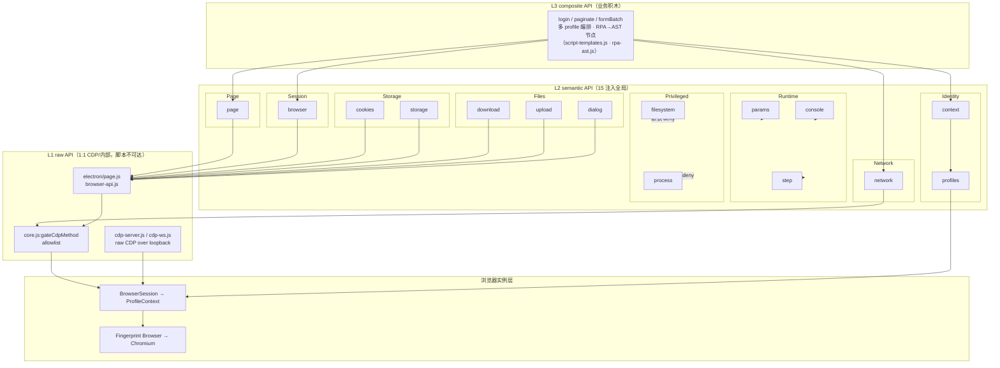

# 12 · API 能力面设计（API Surface Design）

> 性质：研究交付件。**产品架构视角**——把「浏览器/自动化全部能力」封装为**分层、稳定、可版本化、能力可协商**的 API 面（即 SDK 背后的功能分解）。
> **不新建运行时**：API 面坐落于既有 main 进程运行时（`automation/runtime/*` + `automation/electron/*`）与既有 15 个注入全局之上；不新增 IPC/HTTP/CLI 之外的传输，不重定义已有方法名。
> 权威口径：类型签名以 `automation/automation.d.ts`（453 行）为准；命名空间与 as-built 差异以 [06-script-sdk-specification.md](./06-script-sdk-specification.md) §2/§7 为准；**本文不新增方法、不改名**。
> 上游：[00-executive-summary.md](./00-executive-summary.md)；技术选型：[04](./04-automation-technology-selection.md)；系统架构：[05](./05-system-architecture.md)；SDK 规格：[06](./06-script-sdk-specification.md)；数据/API：[07](./07-data-model-and-api.md)；安全可靠性：[08](./08-runtime-security-and-reliability.md)。

---

## 0. 术语与口径

| 项 | 定义 |
|---|---|
| **API 面（surface）** | 脚本可调用的注入全局 + 其类型声明（`automation.d.ts`）。**类型面 = 权限面**：声明里出现的能力才可能被调用。 |
| **能力域（capability domain）** | 功能分解单位（Identity/Launcher/Transport/Page/Storage/Network/Files/Observer/Task/AuthZ），描述「系统能做什么」。 |
| **命名空间域（namespace domain）** | 权限分组单位（Identity/Session/Page/Storage/Network/Files/Runtime/Privileged），描述「脚本按什么权限拿什么」。 |
| **as-built** | 已落地（`script-runner.js` 实际注入）。**target** | 仅 `automation.d.ts`/`script-sdk.md` 声明，未注入。 |
| 状态标记 | ✅ 已建 · ⚠️ 部分/子集 · ⛔ target（未注入） |

> 诚实标注：任务原文称「8 类浏览器能力」，但枚举为 10 项（Identity/Launcher/Transport/Page/Storage/Network/Files/Observer/Task/AuthZ）。本文**按枚举的 10 个能力域**处理，并与 8 个命名空间域交叉映射（§2）。二者是两套正交分解，非计数矛盾。

---

## 1. 设计目标与约束

### 1.1 目标

| # | 目标 | 判定标准（可验证） |
|---|---|---|
| G1 | **封装** | 脚本只见 15 个注入全局；`automation.d.ts` 中不出现 Electron/Node 内建类型（`Electron.Renderer`/`NodeJS.Process`/`fs`），出现即诱导越层（`script-sdk.md` §5）。 |
| G2 | **稳定** | 方法签名一经发布不改；后端（CDP/Electron/Playwright）由 Runtime 选，脚本不感知（`architecture.md` §1 边界规则 1）。 |
| G3 | **可版本化** | `d.ts` 有版本锚（设计态 `script_versions.dts_hash`）；包格式 `fp-script v1`（`script-store.js:356-394`）；破坏性变更须升版（`script-sdk.md` §8）。 |
| G4 | **能力可协商** | 命名空间按 capability 逐项注入、缺失以 `undefined` 呈现（**不静默降级**，`script-runner.js:expose` 注释）；调用方可在执行前查询能力集。 |
| G5 | **权限面 = 类型面** | `PermissionKey`（10 键，`automation.d.ts:309-319`）与 `CAPS`（6 键，`script-store.js:9`）分层校验；未列出项默认 deny。 |
| G6 | **同 Service Layer** | 脚本面与 HTTP/WS/CLI/IPC 共享**同一业务**（`automation-service.js`），无第二份逻辑（`architecture.md` §7）。 |

### 1.2 约束

| 约束 | 内容 | 锚点 |
|---|---|---|
| 单点指纹入口 | 任何 `setFingerprintConfig`/`setSSLConfig`/`setUserAgent`/`fromPartition(http2Profile)` 直调禁止；唯一入口 `context.profile.fingerprint.update` | `profile-manager.js`（五道门）、`architecture.md` §4 |
| debugger main-only | CDP 经 `webContents.debugger`（`core.js:gateCdpMethod` allowlist），永不桥接 renderer/preload | `architecture.md` §3 |
| 禁 sleep 默认路径 | `waitForTimeout` 仅调试逃逸口；发布版禁固定延时 >1000ms | `script-sdk.md` §2.2 |
| 默认超时 30s | 所有方法默认 `timeoutMs=30000`；协议层 `protocolTimeout=30s` | `script-runner.js`/`executor.js`、`runtime.md` §2.2 |
| 禁 `npx` | 依赖从 `node_modules/.bin/` 或 `yarn` | 本仓 `CLAUDE.md` |

### 1.3 与 50 通道 IPC / HTTP / CLI 同一 Service Layer 的关系

API 面是**三条调用路径的交集收敛点**，不是第四条路径：

```
脚本面（15 全局）──┐
Monaco / automation-panel ─┤
外部 REST/WS/CLI ──┼──→ automation-service.js（唯一业务）──→ store / manager / queue / scheduler / profile-manager
Playwright connectOverCDP ─┘        │
                                    └─ 信封 {ok,data,error}；mapError 归一
```

| 调用面 | 传输 | 入口锚点 | 与 API 面关系 |
|---|---|---|---|
| 脚本面 | `node:vm` 注入 15 全局 | `script-runner.js:384-435` | 本文主体；方法名 = `automation.d.ts` |
| IPC | 50 通道（`CHANNEL_MAP`） | `ipc-bridge.js` | 管理面（Script/Profile/Task CRUD）；不暴露页面级方法 |
| HTTP | loopback REST 44 端点 | `http-api.js` | 同上，`{ok,data,error}` 信封 |
| WS | `/api/ws` RPC + 订阅 | `ws-api.js` | 同 HTTP 业务，不同传输 |
| CLI | 薄封装 | `cli.js` | 同 Service 直连（宿主信任域） |
| 外部 CDP | `ws://…/api/cdp/<profileId>` | `electron/cdp-server.js` | 绕过脚本面但**不绕过** allowlist + FP scrub + 审计（`api.md` §6） |

**原则**：页面级能力（page/network/…）**只**经脚本面与外部 CDP 暴露；管理级能力（script/profile/task/schedule/audit/metrics）**只**经 IPC/HTTP/CLI/WS。两条面在 `automation-service.js` 汇合，共享 store/manager。

---

## 2. 能力域分解：能力 → 命名空间 → 关键方法 → 实现锚点

### 2.1 总表（10 能力域 × 8 命名空间域 × 15 全局）

| # | 能力域 | 命名空间域 | 注入全局 | 关键方法（`automation.d.ts`） | Service 通道/端点 | 实现锚点（file） | as-built |
|---|---|---|---|---|---|---|---|
| 1 | **Identity** | Identity | `context`、`profiles` | `context.profile`、`context.get/update`、`context.profile.fingerprint.update`、`profiles.get(id)` | `profiles:get/update/fingerprintUpdate/fingerprintRotate`；`/api/profiles/*` | `profile-manager.js`（五道门）、`script-runner.js:context` | ⚠️ `context`=冻结 `{profile}`；`profiles` ⛔ 未注入 |
| 2 | **Launcher** | Session | `browser`（会话生命周期） | `browser.close()` | `profiles:start/stop/bulkStart`；`/api/profiles/:id/start\|stop` | `electron/launcher.js`、`glue.js`（`createElectronSession`/`restartSession`）、`browser-session.js` | ⚠️ `close` 未注入；start/stop 属 Service 层（脚本不可达） |
| 3 | **Transport** | —（不可达脚本） | —（Adapter 内部） | `core.js:gateCdpMethod` allowlist；raw CDP | 外部 CDP：`GET /api/profiles/:id/cdp` | `core.js`、`electron/page.js`、`cdp-server.js`、`cdp-ws.js` | ✅ 进程内 CDP；raw CDP 仅外部/远程 |
| 4 | **Page** | Page / Session | `page`、`browser` | `page.locator/click/fill/type/press/getText/getAttribute/waitFor*/evaluate`、`browser.goto/back/forward/reload/screenshot/getCurrentUrl/getTitle` | 无（页面级不走管理面） | `electron/page.js`、`browser-api.js`、`input-adapter.js`、`human-input.js` | ⚠️ `page` 子集；`browser` 仅 `goto`/`screenshot` |
| 5 | **Storage** | Storage | `cookies`、`storage` | `cookies.get/set/delete/clear`、`storage.local/session.get/set` | 无 | `browser-api.js`（`electronSession.clearStorageData`） | ✅（partition 作用域） |
| 6 | **Network** | Network | `network` | `network.intercept/waitForRequest/waitForResponse`、`page.waitForResponse/Request` | 无 | `core.js:gateCdpMethod`（Network 只读域）、`browser-api.js` | ⚠️ 仅 `recent`（+条件 `enable`）；`intercept` ⛔ |
| 7 | **Files** | Files | `download`、`upload`、`dialog` | `download.wait/save`、`upload.setFiles`、`dialog.accept/dismiss` | 无 | `browser-api.js:checkPath`（围栏） | ⚠️ `upload` ✅；`download`/`dialog` ⛔ 未注入 |
| 8 | **Observer** | Runtime | `console`、`step` | `console.log/info/warn/error/debug`、`step(name)` | `executions:logs`、`automation:metrics`、`audit:query` | `script-runner.js`（`makeConsole`/`scrubSecrets`）、`metrics.js`、`audit-log.js` | ✅ |
| 9 | **Task** | Runtime | `params`（输入面） | `params[name]`（只读）；Service 面 `run/tasks/schedules` | `automation:run`、`tasks:*`、`schedules:*`；`/api/tasks`、`/api/schedules` | `script-store.js:validateParameters`、`task-queue.js`、`scheduler.js`、`automation-manager.js` | ✅（params ✅；编排属 Service） |
| 10 | **AuthZ** | Privileged | `filesystem`、`process`（+ 全体 capability gate） | `filesystem.*`、`process.*`（默认 `denyProxy`） | `scripts:trust/untrust`、RBAC（JWT `permissions[]`） | `script-runner.js:isAllowed/capAllowed/denyProxy`、`script-store.js:CAPS/DEFAULT_PERMISSIONS`、`ipc-bridge.js`、`http-api.js` | ⚠️ 默认 deny；仅 `permissions=true && trusted=true` 放开 |

### 2.2 能力域职责与边界

| 能力域 | 负责 | 不负责 |
|---|---|---|
| Identity | 身份句柄、profile 元数据读写、指纹变更门禁 | 不负责窗口/页面（交 Page/Session）；不直写指纹载体 |
| Launcher | 会话（窗口）生命周期、CDP attach、崩溃恢复 | 不解释脚本语义；不做任务排队/重试 |
| Transport | 把一次语义调用扇出到 CDP/Electron/Playwright 后端 | 不暴露裸 CDP 句柄给脚本；不开 TCP `--remote-debugging-port` |
| Page | DOM 定位、输入、智能等待、受限求值 | 不做业务判断（交组合层）；不提供裸 `eval` |
| Storage | cookies / local / session 分区读写 | 不跨 profile（跨 profile 只经 `profiles.get`） |
| Network | 请求/响应观测、路由钩子（改写按 capability 授权） | 不改写系统级代理/出站策略（执行侧强制） |
| Files | 下载等待/落盘、上传设文件、原生对话框 | 不越授权目录（围栏 fail-closed） |
| Observer | 结构化日志、步骤标记、指标/审计埋点 | 不承担业务逻辑 |
| Task | typed 参数注入；执行/队列/调度的 Service 面 | 不在脚本内建调度循环（交 Runtime） |
| AuthZ | capability 校验、trust 闸、RBAC、围栏 | 不 fail-open；未知一律 deny |

---

## 3. 资源模型与命名规范

### 3.1 resource-oriented vs verb-oriented：**混合，以 verb 为主**

| 选择 | 适用 | 依据 |
|---|---|---|
| **名词资源 + 动词方法**（混合） | 命名空间即资源（`cookies`/`storage`/`network`/`page`），方法即动词 | 浏览器是有状态会话，纯 REST 资源模型无法表达「等待/点击/导航」的时序语义 |
| **verb-oriented** | 绝大多数操作（`goto`/`click`/`fill`/`waitFor*`/`intercept`） | 自动化以「动作」为原子；动词名可读性最高 |
| **纯 resource-oriented 拒绝** | — | 会把 `page.click` 逼成 `page.clicks.create(...)`，与 `automation.d.ts` 既有签名冲突 |

**结论**：`<namespace>.<verb>(args, opts?)` 为默认形态；`locator`/`context`/`storage.local` 为惰性句柄（noun-first）。**理由**：既保住 d.ts 稳定性，又让 `wait`/`click` 这类动作保持最短调用。

### 3.2 命名一致性规则

| 规则 | 内容 | 反例（禁止） |
|---|---|---|
| R1 动词表 | 固定动词集：`goto/back/forward/reload/close`、`click/fill/type/press`、`get/set/delete/clear`、`wait/waitFor*`、`intercept`、`accept/dismiss`、`setFiles` | 造 `doClick`/`navigateTo` 同义词 |
| R2 opts 约定 | 单个尾参 `opts?` 对象；键 camelCase；`timeout?` 恒为 ms | 位置布尔参 `click(sel, true)` |
| R3 返回一致 | 所有异步方法返回 `Promise<T>`；无 callback；无 EventEmitter（订阅走 WS `subscribe`） | 返回裸值或 `thenable` 混用 |
| R4 超时一致 | 默认 30s；`opts.timeout` 覆盖；`waitFor*` 用 `opts.timeout` | 各方法自造超时键名 |
| R5 异常一致 | 抛 9 类 `ScriptError` 子类（§5.4）；`code` 机器可判 | 抛裸 `Error`/字符串 |
| R6 作用域一致 | cookies/storage 绑当前 `ProfileContext` partition；`page`/`browser` 绑当前 `BrowserSession` | 隐式跨 profile |
| R7 惰性一致 | `locator(sel)` 返回句柄，每次操作重解析（auto-wait） | 提前 resolve 成静态快照 |
| R8 缺失一致 | 未授权/未注入能力以 `undefined` 呈现（干净 `TypeError`），**非** `PermissionError` | 静默返回假数据 |
| R9 只读一致 | `params`、`context.profile.fingerprint` 只读；变更走 `update`/门禁 | 直接改对象 |

---

## 4. 分层与边界：raw / semantic / composite 三层

| 层 | 名称 | 职责 | 面向 | 不应做的事 | as-built 对应 |
|---|---|---|---|---|---|
| **L1** | **raw API** | 与 CDP/内部 1:1 映射：`sendCommand(method,params)` 白名单转发、Electron session 原语 | Runtime / 外部 CDP 客户端（**脚本不可达**） | 不暴露裸句柄给脚本；不做等待/重试；不开 TCP 端口 | `core.js:gateCdpMethod`、`electron/page.js`、`cdp-server.js` |
| **L2** | **semantic API** | 15 个注入全局：`goto`/`click`/`fill`/`waitFor*`/`cookies.*`… 语义化 + smart waits + 自动超时 + 错误分类 | 脚本 | 不感知 partition 名/b64/H2 冻结；不实现业务；不做多步组合 | `browser-api.js`、`input-adapter.js`、`human-input.js` |
| **L3** | **composite API** | 业务积木：`login`/分页遍历/表单批量/多 profile 编排（经 `profiles.get` + ACL）；RPA→AST 节点 | 脚本 / 面板模板 | 不新建运行时/引擎；不绕过门禁；不硬编码站点密钥 | `script-templates.js`（11 内置模板）、`rpa-ast.js`、`rpa-recorder.js` |

**分层规则**：

1. **只向下依赖**：L3→L2→L1；反向依赖禁止（L1 不得知道 `login` 语义）。
2. **能力选择在 L1**：三后端（CDP/Electron/Playwright）由 Runtime 在 L1 选，L2/L3 签名不变（`architecture.md` §5）。
3. **L3 是唯一允许「业务」的层**，且必须可降解为 L2 调用序列（保证同一审计、同一错误类）。
4. **指纹/分区细节止步 L1**：`setFingerprintConfig`/b64/`fromPartition(http2Profile)` 仅 L1 之下可见。

---

## 5. 横切关注点统一封装

### 5.1 超时

| 项 | 约定 | 锚点 |
|---|---|---|
| 默认 | `timeoutMs=30000`（脚本方法、`executor.js`） | `script-runner.js` |
| 协议层 | `protocolTimeout=30s` | `runtime.md` §2.2 |
| 覆盖 | 每方法 `opts.timeout` | `automation.d.ts` 各 `*Opts` |
| 逃逸 | `page.waitForTimeout(ms)` 仅调试；发布版禁固定延时 >1000ms | `script-sdk.md` §2.2 |

### 5.2 取消（AbortSignal / 取消句柄）

| 通道 | 语义 | 锚点 |
|---|---|---|
| 脚本内 | `step(name)` 为协作式中断点：命中取消即抛 `CancelledError` | `script-runner.js`（`step`） |
| 运行级 | `runScriptCancellable` + `signal` | `automation-manager.js` |
| 队列级 | `tasks:cancel` / `pause{interrupt:true}` → worker `abortItem` | `task-queue.js`、`worker.js` |
| 终态 | `CancelledError` 不在 9 类 taxonomy，走终态 `CANCELLED`，**不进 `RETRYING`** | `06` §4 |

### 5.3 重试与幂等

| 类别 | 幂等 | 可重试 | 说明 |
|---|---|---|---|
| 查询（GET / `get*`） | 是 | — | 无副作用 |
| `goto`/`click`/`fill` 等页面操作 | **否**（站点语义） | 见下 | 重试可能重复提交（`08` §2.6） |
| `cookies.set`/`storage.set` | 是（覆盖写） | 是 | 幂等覆盖 |
| `download.save` | 视目标 | `DownloadError` 默认 `false`（Task 基线 `true`） | 落盘失败 |
| `upload.setFiles` | 是 | `UploadError` `false` | 路径越界不可重试 |
| Service `run`/`enqueue` | **否**（新 id） | — | `idempotency_key` 仅设计态（`database.md` §5） |

**retriable 集合（Task 层基线）**：`true` = `NetworkError`/`TimeoutError`/`DownloadError`/`UploadError`；`false` = `BrowserError`/`PermissionError`/`ScriptError`/`ProfileError`/`SelectorError`。判定口径：`err.retriable` 显式值 > 类默认 > 分类表（`script-sdk.md` §6.1、`task-queue.js:classify`）。退避默认 `{max:3, baseMs:5000, mult:3, jitter:0.2}`（`task-queue.js:33`）。

### 5.4 错误分类（9 类）

| 类 | `code` | retriable | 触发 | audit 强制 |
|---|---|---|---|---|
| `ScriptError`（基类） | `SCRIPT` | false | 脚本逻辑/参数校验 | 否 |
| `TimeoutError` | `TIMEOUT` | **true** | 等待/操作超时 | 否 |
| `SelectorError` | `SELECTOR` | false | 选择器不存在/多义 | 否 |
| `BrowserError` | `BROWSER` | false | 窗口/session/导航故障 | 否 |
| `NetworkError` | `NETWORK` | **true** | 请求失败/断连 | 否 |
| `PermissionError` | `PERMISSION` | false | RBAC/ACL/沙箱/围栏拒绝 | **是** |
| `ProfileError` | `PROFILE` | false | `profiles.get` 失败/隔离违规 | **是** |
| `DownloadError` | `DOWNLOAD` | false（Task 基线 true） | 下载超时/落盘失败 | 否 |
| `UploadError` | `UPLOAD` | false | `setFiles` 越界/文件不存在 | 否 |

`classify()` 顺序（`script-runner.js:126-157`）：instanceof → `err.name` → `err.code` 前缀表 → `SyntaxError`→`ScriptError` → 含 `timed out`→`TimeoutError` → 兜底 `ScriptError`。

### 5.5 日志 / 审计

| 层 | 载体 | 锚点 |
|---|---|---|
| 执行日志 | `console.*`→`record.logs`（`MAX_LOGS=1000`，超限丢新行） | `script-runner.js:307-318` |
| live 推送 | `onLog`→`automation:event`→panel | `wire.js`、`preload.js` |
| 审计 | `audit-log.js` 内存 ring 10000 + 可选 JSONL；只记 `channel/status/code`，**永不记 args** | `ipc-bridge.js`、`http-api.js` §1 |
| 指标 | `metrics.js` 终态喂 record | `metrics.js` |

### 5.6 secret 脱敏

| 环节 | 机制 | 锚点 |
|---|---|---|
| 参数边界 | `cleanInput` 去 `__proto__`/`constructor`/`prototype` | `script-runner.js:214-238` |
| 名称收集 | `secret` 参数名进 `secretNames` | `script-store.js` |
| 渲染 | `scrubSecrets` 一律 `***`；审计门口二道脱敏 | `script-runner.js`、`audit-log.js` |
| 落库 | secret 只存 `secret_ref`（设计态），永不存明文 | `database.md` §3/§11 |

### 5.7 能力 / 权限校验

| 门 | 机制 | 锚点 |
|---|---|---|
| store 写入校验 | `CAPS`（6 键）过滤 | `script-store.js:9` |
| 运行注入分组 | `CAP_KEYS`（10 键） | `script-runner.js:115` |
| 未授权 deny | `isAllowed`/`denyProxy` 抛 `PermissionError` | `script-runner.js:isAllowed` |
| trust 闸 | `filesystem`/`process` 需 `permissions=true && trusted=true`（`trustResolver`，失败=deny，永不 fail-open） | `script-runner.js:414-429` |
| 类型面 | `PermissionKey`（10 键） | `automation.d.ts:309-319` |
| 管理面 RBAC | JWT `permissions[]`（admin/viewer/team） | `http-api.js` §7 |

### 5.8 批处理（bulk）

| 场景 | 入口 | 锚点 |
|---|---|---|
| 多 profile 批量 | Service `profiles:bulkStart`（`concurrency=5`） | `profile-manager.js` |
| Task 扇出 | `scheduler` 展开 N profile → queue | `scheduler.js`、`task-queue.js` |
| 并发上限 | `automation-manager.js:maxConcurrent=5`；worker semaphore；同 profile 串行 | `worker.js` |
| 脚本内多 profile | 仅经 `profiles.get(id)` 逐个（无 `list()`，不可枚举） | `06` §3.11 |

---

## 6. 版本与兼容策略

| 维度 | 策略 | 锚点 |
|---|---|---|
| 语义化版本 | `ScriptMetadata.version` semver（`nextVersion` patch 自增）；破坏性变更升 `d.ts` 版本 | `script-store.js:nextVersion` |
| 类型锚定 | 设计态 `script_versions.dts_hash` 锚定 `automation.d.ts` 版本 | `database.md` §2 |
| 包格式 | `fp-script v1`：`{format:'fp-script',v:1,script,version,code}`；`v!==1` 拒绝、fresh uuid 永不覆盖、trust 位不随包携带 | `script-store.js:356-394` |
| 版本不可变 | `addVersion` 成功即使旧签名失效（`trusted→false`） | `script-store.js:addVersion` |
| 发布态 | 执行必须绑定 version；回滚 = 指向上一个 Version | `architecture.md` §9 |

### 6.1 能力协商握手（capability handshake）

**问题**：不同运行时/打包形态注入的命名空间子集不同（如 packaged 无 `../automation` 时降级，`05` §8.1），脚本若硬调缺失能力只会得到 `undefined`→`TypeError`。

**目标握手**（在既有 `undefined` 呈现语义上做**只读探测**，不改方法名）：

| 步骤 | 内容 |
|---|---|
| 1 | Runtime 在注入时构造能力集 `{namespace: boolean}`，来源 = `CAP_KEYS` ∩ 实际注入（`script-runner.js:expose`）。 |
| 2 | 脚本可读 `context` 只读快照探测（设计态扩展 `context.get()` 返回含 `capabilities`），**不新增全局**。 |
| 3 | 面板/IDE 依能力集灰化不可用 API（对齐 `test-automation-panel-degrade.js` 的 probeBridge 模式）。 |
| 4 | 外部调用方经 `GET /api/automation/status` 的 `components` 读同一能力集。 |

> 握手是**只读契约**；缺失能力继续以 `undefined` 呈现（R8），握手只提前告知，不改变运行语义。

### 6.2 废弃流程

| 阶段 | 动作 |
|---|---|
| D1 标注 | `d.ts` 加 `@deprecated` + 替代方法名；`script-sdk.md` 同步 |
| D2 双写 | 旧方法保留、内部转调新方法（一个 minor 周期） |
| D3 告警 | 调用旧方法记 warn 日志（不阻断） |
| D4 移除 | 下一个 major 升 `d.ts` 版本；`fp-script` 导入时对旧 API 给迁移提示 |
| 硬规则 | 删除/改名须同时改 `automation.d.ts` 与 `script-sdk.md`（两份同改，`06` §8） |

---

## 7. 覆盖度检查表（对照 [02-competitor-matrix.md](./02-competitor-matrix.md)）

> 口径：确认「竞品矩阵中每一类能力都有对应 API 封装」；显式列出 as-built 缺失/仅子集的命名空间（见 `06` §2/§7）。

### 7.1 竞品能力 → 本方案 API 封装

| 竞品能力（02 表） | 本方案封装 | 状态 |
|---|---|---|
| profile CRUD / 实例启停（4.3） | Service `profiles:*`；脚本 `context`/`profiles.get` | ✅ 管理面；⚠️ 脚本面 `context` 子集 |
| 标签页/窗口/导航（4.3） | `browser.goto/back/forward/reload`；`browser.close` | ⚠️ `goto` ✅；back/forward/reload/close ⛔ |
| DOM 查询与元素操作 / 点击输入（4.3） | `page.*`、`locator.*` | ⚠️ 子集（`locator`/`back`/`forward`/`reload` 缺失） |
| 截图 / PDF（4.3） | `browser.screenshot`、`context.screenshot` | ✅ 截图；PDF 未列（无 API） |
| Cookie（4.3） | `cookies.get/set/delete/clear` | ✅ |
| localStorage（4.3） | `storage.local.get/set` | ✅ |
| **sessionStorage（4.3，8 家全未确认）** | `storage.session.get/set` | ⚠️ d.ts 已声明；as-built 注入待核 |
| IndexedDB（4.3，仅 MoreLogin） | — | ❌ **无 API**（差异化缺口，见 §7.3） |
| 网络请求监听（4.3） | `network.intercept/waitForRequest/waitForResponse` | ⚠️ 仅 `recent`；`intercept` ⛔ |
| 页面 JS 执行（4.3） | `page.evaluate`（受限：超时+截断脱敏） | ⚠️ 条件暴露 |
| 文件上传/下载（4.3） | `upload.setFiles`、`download.wait/save` | ⚠️ `upload` ✅；`download` ⛔ |
| 浏览器通知/弹窗（4.3） | `dialog.accept/dismiss` | ⛔ 未注入 |
| 多标签切换（4.3） | `browser`（会话窗口） | ⛔ 无 tab API |
| 运行状态查询（4.3） | Service `status`、`profiles:status` | ✅ 管理面 |
| 任务状态机 / 队列 / 重试 / 超时（4.6） | Service `tasks:*`；`classify`+退避 | ✅ |
| 定时/周期执行（4.6） | Service `schedules:*` | ✅ |
| 优先级（4.6，8 家全未确认） | `task.priority`（claim 取高） | ✅ 差异点 |
| 幂等键（4.6，8 家空白） | 设计态 `idempotency_key` | ⚠️ 设计未实现 |
| 执行日志 / 历史 / 产物（4.6） | `console.*`、`executions:logs`、`metrics` | ✅ |
| 脚本版本管理（4.5，8 家全空白） | `scripts:saveVersion` + 不可变版本 | ✅ 差异点 |
| 代码级编辑器（4.5，8 家全空白） | Monaco + `automation.d.ts` | ⚠️ 惰性可选 |
| 可视化编排（4.1） | RPA→AST 同一运行时 | ⚠️ 部分 |
| 模板库 / 导入导出（4.7） | `templates:*`、`export/import` | ✅ |
| 团队权限（4.7） | RBAC（JWT `permissions[]`） | ✅ |
| init/cleanup 钩子（4.1，8 家全空白） | — | ❌ **无 API**（差异化缺口） |

### 7.2 as-built 缺失 / 仅子集的命名空间（诚实清单，对齐 `06` §2/§7）

| 命名空间 | d.ts（target） | as-built 注入 | 缺口性质 |
|---|---|---|---|
| `context` | 完整 `AutomationContext`（get/update/cookies/storage/screenshot/fingerprint） | 仅 `Object.freeze({profile})` | 语义子集 |
| `browser` | 8 方法 | 仅 `goto`/`screenshot` | 方法子集 |
| `page` | 20 方法 | 子集（`locator`/历史导航缺失） | 方法子集 |
| `network` | intercept + 2 waitFor | 仅 `recent`（+条件 `enable`） | 方法子集 |
| `download` | wait/save | **未注入 vm** | 未注入 |
| `dialog` | accept/dismiss | **未注入 vm** | 未注入 |
| `profiles` | `get(id)` | **未注入 vm** | 未注入 |
| `filesystem`/`process` | `unknown` | `denyProxy`（默认 deny） | 默认拒绝（设计如此） |

### 7.3 差异化缺口（自研补强点，来自 02 结论）

| 缺口 | 竞品状态 | 本方案对策 |
|---|---|---|
| sessionStorage 控制 | 8 家全未确认 | `storage.session` 已入 d.ts，需补注入验证 |
| IndexedDB 控制 | 仅 MoreLogin | 待评估（OQ-14） |
| init/cleanup 钩子 | 8 家全空白 | 待设计（OQ-13） |
| 脚本版本管理 | 8 家全空白 | ✅ 已实现（差异点） |
| 优先级调度 | 8 家全未确认 | ✅ `priority` 已实现 |
| 幂等键 | 8 家空白/不幂等 | ⚠️ 设计态待落地 |

---

## 8. Mermaid：能力域分层图



---

## 9. 与 00–11 的一致性 + 与 docs/automation 的关系

### 9.1 与 00–11 的一致性

| 本文结论 | 对齐文档 | 一致点 |
|---|---|---|
| 15 全局 / 8 命名空间域 | [06](./06-script-sdk-specification.md) §2 | 命名空间清单与 as-built 注入表逐项一致 |
| 9 错误类 / retriable 集合 | [06](./06-script-sdk-specification.md) §4、[08](./08-runtime-security-and-reliability.md) | 与 `classify`/`task-queue` 一致 |
| 能力域分解 | [05](./05-system-architecture.md) §4 模块边界 | 命名空间映射到既有模块职责 |
| 三层（raw/semantic/composite） | [04](./04-automation-technology-selection.md) ADR-1/2、[05](./05-system-architecture.md) §3 | raw=Adapter、semantic=SDK、composite=RPA/模板 |
| 覆盖度对照 | [02](./02-competitor-matrix.md) 4.1–4.7 | 逐类能力有封装或显式缺口 |
| 版本/包格式 | [06](./06-script-sdk-specification.md) §8、[07](./07-data-model-and-api.md) §2.2 | `fp-script v1`、`dts_hash`、semver |
| 能力协商握手 | [05](./05-system-architecture.md) §8.1、[06](./06-script-sdk-specification.md) §2 | 基于 `undefined` 呈现与降级模式 |
| 未决项 | [11](./11-open-questions.md) OQ-13/14/22/23 | init/cleanup、IndexedDB、connectOverCDP 共存、token 轮换 |

### 9.2 与 `docs/automation` 的关系（delta）

#### 新增（本文首次成文）

| 条目 | 说明 |
|---|---|
| 能力域 → 命名空间 → 方法 → 锚点**总表** | 原 `script-sdk.md`/`architecture.md` 分述分层，无「能力域 × 命名空间 × 锚点」单表 |
| **三层 API 模型**（raw/semantic/composite）显式化 | 原文隐含于 Adapter/SDK，未命名三层与各自边界 |
| **命名一致性规则 R1–R9** | 原文档无系统化命名/opts/Promise/异常约定表 |
| **能力协商握手** | 原 `undefined` 呈现语义未形式化为握手契约 |
| **覆盖度检查表**（对照竞品矩阵） | 原文档无「竞品能力 → 本方案 API」逐项对照 |
| 废弃流程 D1–D4 | 原文档仅「破坏性变更升版」，无阶段化流程 |

#### 修改（相对既有文档的修正/收敛）

| 项 | 既有表述 | 本文 |
|---|---|---|
| `context` 语义 | `script-sdk.md` §2.5 完整 ProfileContext | 显式标注 as-built 仅冻结 `{profile}`（与 `06` §2 对齐） |
| `browser`/`page`/`network` 子集 | d.ts 全集 | 显式标注方法子集与 ⛔ 未注入项 |
| 权限键计数 | store 6 / runner 10 / d.ts 10 | 明示三者分层（store 写校验、runner 注入、d.ts 类型面） |

#### 废弃 / 刻意缺席

| 条目 | 说明 |
|---|---|
| 裸 CDP 句柄 / `sendCommand` 暴露给脚本 | 硬性禁止（`runtime.md` §7.2）；L1 仅 Runtime/外部可达 |
| `sleep`/固定延时默认等待 | 刻意缺席（`script-sdk.md` §2.2） |
| `profiles.list()` 枚举 | 刻意缺席（跨 profile 只能 `get(id)`，不可枚举） |
| d.ts 中的 Electron/Node 内建类型 | 硬性禁止（权限面原则） |

---

## 10. 引用

- SDK 规格：[06-script-sdk-specification.md](./06-script-sdk-specification.md)；类型面：[../../automation/automation.d.ts](../../automation/automation.d.ts)
- 架构：[05-system-architecture.md](./05-system-architecture.md)；选型：[04-automation-technology-selection.md](./04-automation-technology-selection.md)
- 数据/API：[07-data-model-and-api.md](./07-data-model-and-api.md)；安全可靠性：[08-runtime-security-and-reliability.md](./08-runtime-security-and-reliability.md)
- 竞品矩阵：[02-competitor-matrix.md](./02-competitor-matrix.md)；未决项：[11-open-questions.md](./11-open-questions.md)
- 内部设计：[../automation/script-sdk.md](../automation/script-sdk.md)、[../automation/architecture.md](../automation/architecture.md)、[../automation/api.md](../automation/api.md)、[../automation/database.md](../automation/database.md)
