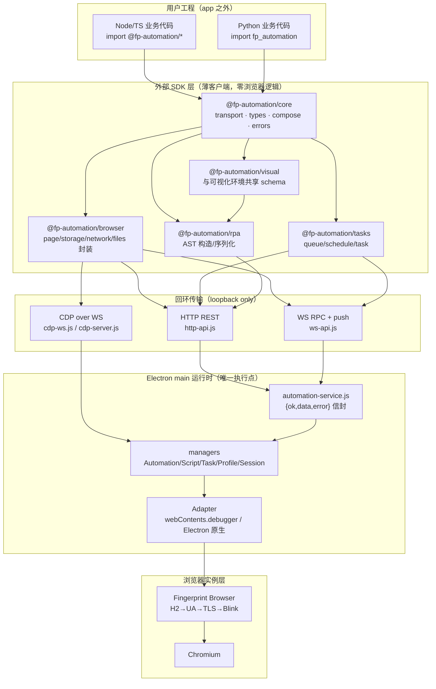

# 14 · 外部 SDK 设计（External SDK Design）

> 性质：研究交付件。**新增设计**：把 SDK 放到 app **之外**，让用户在自己的工程里像**搭积木**一样组装业务逻辑。
> 口径：区分「现状（as-built）」与「目标（target）」；现状证据带精确路径，未读码不写。本文不新增运行时控制面，不重造浏览器逻辑。
> 上游：[00-executive-summary.md](./00-executive-summary.md)、[04-automation-technology-selection.md](./04-automation-technology-selection.md)、[05-system-architecture.md](./05-system-architecture.md)、[06-script-sdk-specification.md](./06-script-sdk-specification.md)。
> 相关：`../automation/api.md`（回环 REST/WS 契约）、`../automation/script-sdk.md`（注入式 API 权威）、`../../automation/automation.d.ts`（453 行类型面 = 权限面）。
> 说明：本包 00–15；本文为 14。接口面以 [12-api-surface-design.md](./12-api-surface-design.md) 与 [07-data-model-and-api.md](./07-data-model-and-api.md) 为准；可视化 schema 见 [15-visual-scripting-environment.md](./15-visual-scripting-environment.md)（共享节点命名契约）。

---

> **分发范围说明（见 [16-zero-runtime-distribution-constraints.md](./16-zero-runtime-distribution-constraints.md)）**：本文的外部 SDK 是**面向选择用代码组装的用户的一等设计路径**；用户使用 SDK 时**自备 Node/Python 环境**（自行安装，属预期行为，不受产品分发约束 C1 限制）。产品另有面向非开发者的**应用内零安装路径**（可视化环境 + 内置编辑器）。两条路径并存，互不替代；**产品自身的分发**不依赖外部解释器。

## 1. 设计目标与原则

| # | 原则 | 含义 | 反例（禁止） |
|---|---|---|---|
| P1 | **外部化（out-of-app）** | 用户代码在**自己的** Node/Python 工程里（用户自备解释器，属预期；见 [16](./16-zero-runtime-distribution-constraints.md)）；SDK 是被 `npm install` / `pip install` 的薄客户端。 | 把用户业务塞进 app 的 renderer 或 app 目录 |
| P2 | **薄封装（thin client）** | SDK 只做：连接、鉴权、重试、错误映射、类型、序列化。**零浏览器逻辑**。 | 在 SDK 里重写选择器等待、指纹、会话管理 |
| P3 | **语言无关（polyglot）** | 一份 IDL → TypeScript/Node（主）+ Python（次）绑定；传输层手写、类型层生成。**注意**：polyglot 面向自备 Node/Python 的集成者（[16](./16-zero-runtime-distribution-constraints.md)）。 | 每种语言各写一套业务语义 |
| P4 | **可组合（composable）** | 原子操作 → 组合器 → 预置块，纯函数式拼装（搭积木）。 | 巨型单文件脚本、隐式全局副作用 |
| P5 | **可版本化（versioned）** | SDK SemVer + 运行时协议版本，握手协商、能力位门控、可降级。 | 无版本探测直接调用 |
| P6 | **零浏览器逻辑** | 页面/等待/指纹/会话**全在运行时**；SDK 通过回环 API/CDP 转发。 | SDK 内实现 auto-wait、CDP 补丁、反检测 |
| P7 | **安全默认** | 仅 loopback（`127.0.0.1`）；Bearer 常数时间比较；能力经 `PermissionKey` 由 runtime 强制；token 不落日志。 | 绑 `0.0.0.0`、在 SDK 内放行能力、明文存 token |
| P8 | **可扩展（DI）** | transport / step / 等待策略 / 日志 sink / secret provider / 插件全部可注入。 | 硬编码单例、不可替换的全局 |

> P2/P6 是本文的**边界铁律**：SDK 越像「驱动」，就越会与运行时的 `node:vm` / `webContents.debugger` 双实现漂移。SDK 的职责上限 = **把一次调用翻译成一次回环请求**。

---

## 2. 分层与边界（Mermaid）



**边界规则（与 `../automation/architecture.md` §1 一致）**：

1. 外部 SDK **只能**走 Service Layer（HTTP/WS）或 CDP，**不直调** manager。
2. IPC（`ipc-bridge.js` 50 通道）**仅 app 内**（panel/preload）；外部 SDK **不使用** IPC。
3. 页面级控制：默认走 CDP（`connectOverCDP` 语义，见 `../automation/api.md` §6）；管理/编排走 HTTP/WS。
4. 指纹变更唯一入口仍是 `FingerprintBroker`（`POST /api/profiles/:id/fingerprint[-rotate]`）；SDK **不暴露** `setFingerprintConfig` / `setSSLConfig` / `setUserAgent` / `fromPartition`。

---

## 3. 包结构（monorepo 分层）

### 3.1 包清单与职责

| 包名（建议） | 层 | 职责 | 依赖 | 发布 |
|---|---|---|---|---|
| `@fp-automation/core` | L0 | **transport**（HTTP/WS/CDP 连接、鉴权、重试、错误映射、capability handshake）+ **共享类型**（由 `automation.d.ts` 生成）+ **组合引擎**（compose/pipe/sequence/parallel/map/branch/middleware）+ `Registry` + `errors` | 无（Node 内建） | npm |
| `@fp-automation/browser` | L1 | `page` / `storage` / `network` / `files` / `cookies` 的**高层封装**（薄转发，无等待引擎） | core | npm |
| `@fp-automation/tasks` | L1 | queue / schedule / task 的提交与轮询；`blocks.*` 预置块 | core | npm |
| `@fp-automation/rpa` | L1 | AST/块的构造与序列化（共享 `rpa-ast.js` 节点 schema） | core | npm |
| `@fp-automation/visual` | L2 | 与可视化环境共享的 schema + builder（见配套文档 15） | rpa | npm |
| `@fp-automation/sdk` | meta | 伞包：re-export 上述全部 + `createClient` | 全部 | npm |
| `fp-automation`（PyPI） | L1 | Python 绑定：管理面 OpenAPI 客户端 + 数据面 CDP 客户端 | requests/httpx + websockets | pip |

> 目录建议：`sdk/`（本仓新增，与 `automation/` 平级或独立 repo）——`packages/core`、`packages/browser`、`packages/tasks`、`packages/rpa`、`packages/visual`、`packages/sdk`、`bindings/python`、`idl/`、`scripts/gen/`。**本仓约束**：SDK 的构建脚本**禁止 `npx`**（见 `CLAUDE.md`），一律 `yarn <tool>` 或 `node_modules/.bin/<tool>`。

### 3.2 依赖方向（单向，无环）

```
visual ─┐
        ├─→ rpa ─┐
tasks ──┼────────┼─→ browser ─→ core
        └────────┘
sdk (meta) ─→ 以上全部
python ─→ idl/（生成）  （不依赖 TS 包，独立实现传输）
```

### 3.3 类型来源（单一事实源）

| 事实源 | 用途 | 生成物 |
|---|---|---|
| `automation/automation.d.ts`（453 行 ambient） | 脚本注入面 = 权限面 | SDK `types/`（去掉 `declare const`，转为 `interface` + 客户端 `Browser`/`Page` 类型） |
| `docs/automation/api.md`（REST 端点表） | 管理面 | OpenAPI 3.1（`idl/openapi.yaml`） |
| `runtime/ws-api.js`（`buildMethods` 的 read/write 方法名） | WS RPC 面 | OpenAPI 扩展 / 方法清单 |
| `runtime/rpa-ast.js`（26 节点） | RPA AST | JSON Schema（`idl/rpa-ast.schema.json`），rpa/visual 共享 |
| `script-runner.js`（9 错误类） | 错误面 | SDK error 类（wire code → 类） |

> 生成工具：TypeScript 用 `openapi-typescript`（仅类型）；Python 用 `openapi-generator`（仅管理面）。**传输层手写**——生成器产出的 transport 不可控，且本仓禁止 `npx`，生成脚本走 `yarn`。

---

## 4. 传输层与能力握手（`@fp-automation/core`）

### 4.1 Transport 接口（可注入）

```ts
interface Transport {
  request<T>(method: HttpMethod, path: string, body?: unknown): Promise<T>; // REST
  rpc<T>(method: string, params?: Record<string, unknown>): Promise<T>;      // WS
  subscribe(executionId: string, onEvent: (e: ExecutionEvent) => void): () => void;
  connectCdp(profileId: string): Promise<CdpEndpoint>;                       // 解析 cdpUrl
  close(): Promise<void>;
}
interface CdpEndpoint { cdpUrl: string; inProcess: boolean; }
```

| 内置实现 | 对应运行时 | 用途 | 关键事实（as-built） |
|---|---|---|---|
| `HttpTransport` | `runtime/http-api.js` | 管理/编排（CRUD/run/tasks/schedules/profiles/metrics/audit） | 仅 `127.0.0.1`；Bearer；Host/Origin/CORS 三门；60 req/min/token；body ≤1MB；信封 `{ok,data,error}`（`api.md` §1/§3） |
| `WsTransport` | `runtime/ws-api.js` | RPC + 执行终态推送（250ms） | `GET /api/ws?token=`（浏览器无法在握手设 header，故 token 走 query）；read 方法双角色、write 需 admin；`subscribe{executionId}`（`api.md` §8） |
| `CdpTransport` | `runtime/cdp-ws.js` / `electron/cdp-server.js` | 页面级控制（薄透传） | `ws://127.0.0.1:<port>/api/cdp/<profileId>?token=<token>`；`GET /api/profiles/:id/cdp` 返回 `endpoint.cdpUrl`（`api.md` §6） |

### 4.2 鉴权与安全（对齐运行时门）

| 关卡 | SDK 侧行为 | 运行时侧（权威） |
|---|---|---|
| token | 从 `token` / `secret provider` / env 注入；**绝不写日志** | `Authorization: Bearer`；sha256 + `timingSafeEqual` |
| loopback | 拒绝非 `127.0.0.1`/`localhost` 的 baseUrl（fail-fast） | Host 白名单 + `start()` 拒非 loopback |
| WS | token 走 `?token=`（协议限制） | loopback + Bearer/viewer 三门 |
| CDP | token 走 `?token=` | 同 cdp-ws 门；`debugPort` 默认 null（ADR-3） |
| 能力 | 不自行放行；只声明期望 | `PermissionKey` 由 runtime RBAC/ACL/沙箱强制 |

### 4.3 capability handshake

```ts
interface Handshake {
  protocol: number;                 // 整数协议版本（major）
  runtimeVersion: string;           // 运行时 SemVer
  capabilities: string[];           // 能力位（feature gate）
  deprecated: Array<{ feature: string; since: string; sunset?: string }>;
}
const hs = await client.handshake(); // 读 GET /api/automation/status
```

| 现状（as-built） | 目标（target，additive） |
|---|---|
| `GET /api/automation/status` → `{ components:{store,queueDepth,running,schedules}, uptimeSec }` | 同一 `data` 增 `protocol` / `capabilities` / `deprecated`（**加字段，不改既有字段**）；请求头 `X-FP-SDK-Protocol`，响应头 `X-FP-Runtime` |

能力位建议（由现有端点派生，不新造语义）：`scripts`、`versions`、`tasks`、`schedules`、`profiles`、`cdp`、`metrics`、`audit`、`rbac.jwt`、`fingerprint.rotate`。SDK 调用前用 `caps.has(x)` 门控；缺失即抛 `UnsupportedCapabilityError`（不静默降级）。

### 4.4 错误映射（wire → SDK 类）

SDK 复用运行时 **9 类错误 + `CancelledError`** 的 `code`/`retriable`（`06-script-sdk-specification.md` §4），把信封 `error.code` 映射为同名类：

| HTTP / WS code | SDK 类 | `retriable` |
|---|---|---|
| `VALIDATION` | `ScriptError`（`code:'SCRIPT'`） | `false` |
| `TIMEOUT` / `TimeoutError` | `TimeoutError` | `true` |
| `SELECTOR` | `SelectorError` | `false` |
| `BROWSER` | `BrowserError` | `false` |
| `NETWORK` | `NetworkError` | `true` |
| `PERMISSION` | `PermissionError` | `false`（**强制审计**） |
| `PROFILE` | `ProfileError` | `false`（**强制审计**） |
| `DOWNLOAD` / `UPLOAD` | `DownloadError` / `UploadError` | 类默认 |
| `CANCELLED` | `CancelledError` | `false`（终态） |
| `NOT_FOUND` / `CONFLICT` / `LIMIT` / `RATE_LIMITED` / `FORBIDDEN` / `UNAUTHORIZED` / `INTERNAL` / `NOT_IMPLEMENTED` | `TransportError`（带 `httpStatus` + `code`） | `false`（`RATE_LIMITED`/`LIMIT` 可由组合器策略重试） |

映射表在 `core` 内单点实现，**不逐调用复制**。

---

## 5. 积木式组装模型（核心）

### 5.1 三个原语

```ts
type Op<I = unknown, O = unknown> = (input: I, ctx: OpContext) => Promise<O>;

interface OpContext {
  client: Client;                    // 提供 transport / browser / tasks / rpa
  profileId?: string;                // withProfile 注入
  log: Logger;                       // 可注入 sink
  secrets: SecretProvider;           // 可注入 secret provider
  signal: AbortSignal;               // 取消
  wait?: WaitStrategy;               // 可注入等待策略
  caps: Set<string>;                 // handshake 能力位
}
```

| 原语 | 定义 | 例子 |
|---|---|---|
| **原子操作（atom）** | 一次 SDK 调用 / 一个纯函数；`Op` 的最小单位 | `sdk.profiles.start(id)`、`sdk.tasks.enqueue(spec)`、`(rows) => rows.flat()` |
| **组合器（combinator）** | 把 `Op` 组合成新 `Op` 的**纯函数** | `pipe` / `sequence` / `parallel` / `map` / `branch` / `compose` |
| **中间件（middleware）** | `(op) => op` 的横切包装 | `withRetry` / `withProfile` / `withHumanize` / `withLog` / `withTimeout` / `withSecret` / `withFallback` |
| **预置块（block）** | 打包好的 `Op`（模板/组合） | `blocks.login` / `blocks.scrapeList` / `blocks.exportCsv` |

### 5.2 组合器语义表

| 组合器 | 签名（概念） | 语义 | 备注 |
|---|---|---|---|
| `pipe(...ops)` | `Op[] → Op` | 顺序数据流：前一个输出 = 后一个输入 | 业务主线 |
| `sequence(...ops)` | `Op[] → Op` | 顺序执行，**共享同一输入**，收集结果数组 | 无数据依赖的步骤 |
| `parallel(...ops, opts)` | `Op[] → Op` | 并发执行，收集结果 | `{concurrency}` |
| `map(selector, op, opts)` | `(I)=>I[], Op, opts → Op` | 扇出：对列表每项跑 `op` | `{concurrency, serializeBy}`（同 `profileId` 串行，对齐 `worker.js` 语义） |
| `branch(pred, ifTrue, ifFalse)` | `Op` | 条件分支 | `pred` 可为 `Op` 或纯判定 |
| `compose(...mws)` | `Middleware[] → Middleware` | 右到左套用中间件 | 与 `pipe` 组合使用 |
| `retry(op, policy)` | `Op, RetryPolicy → Op` | 重试（等价 `withRetry(policy)(op)`） | `on` 读 `err.retriable` |

`RetryPolicy`：`{ attempts, backoff: 'fixed'|'exponential', baseMs, maxMs, jitter, on?: (e)=>boolean }`。默认 `on = e => e.retriable`，**与运行时 `task-queue.js` 的 retriable 分类一致**（`06` §4）。

### 5.3 中间件语义表

| 中间件 | 作用 | 边界 |
|---|---|---|
| `withRetry(policy)` | 包裹 `op`，按 `policy.on` 重试 | 只重试 `retriable`；`PermissionError`/`ProfileError` 永不重试 |
| `withProfile(idOrFn)` | 向 `ctx.profileId` 注入身份，并让 `browser.*` 绑定该 profile | 跨 profile 仍须运行时 ACL 授权，SDK 不越权 |
| `withHumanize(opts)` | 类人输入：按键延迟区间、鼠标抖动、节奏 | **委托**运行时 `human-input.js` / `seeded-rng.js` 语义；SDK 不实现算法 |
| `withLog(prefix, sink?)` | 步骤日志到注入的 `Logger` | 默认 console sink；secret 走 scrub |
| `withTimeout(ms)` | 整体超时 → `TimeoutError` | 与运行时默认 `timeoutMs=30000` 对齐 |
| `withSecret(ref)` | 从 `SecretProvider` 解析值，注入并脱敏 | 值不落日志；等价运行时 `secret` 参数 |
| `withFallback(op, fallback)` | 主 op 失败（非 retriable）时执行 fallback | 明确降级意图，非静默 |

> `withHumanize`/`withRetry` 等**不重写浏览器算法**：它们只调整「调用节奏/调用次数/上下文」，把真正的等待/输入执行交给运行时（Path B）或 CDP（Path A）。

### 5.4 完整示例：用积木搭「多 profile 登录 → 抓取 → 导出」

```ts
// my-project/src/multi-profile-export.ts  （用户工程，app 之外）
import {
  createClient, pipe, sequence, parallel, map, branch,
  withRetry, withProfile, withHumanize, withLog, withSecret,
} from '@fp-automation/core';
import { blocks } from '@fp-automation/tasks';

// 1) 建客户端：全部扩展点可注入（见 §6）
const client = await createClient({
  baseUrl: process.env.FP_BASE_URL!,          // http://127.0.0.1:<port>
  token: process.env.FP_TOKEN!,               // Bearer；仅 loopback
  // transport?: myTransport, logger?: myLogger, secrets?: myVault, wait?: myWait,
});

// 2) 能力握手：不匹配即明确失败，不静默降级
const caps = await client.handshake();
if (!caps.capabilities.includes('schedules')) throw new Error('runtime too old');

// ---- 原子操作（atoms）----
const openProfile  = blocks.profileStart();          // POST /api/profiles/:id/start
const closeProfile = blocks.profileStop();           // POST /api/profiles/:id/stop

// ---- 组合器 + 中间件：把原子拼成一条业务 ----
const scrapeOneProfile = compose(
  withProfile((input) => input.profileId),           // 注入身份 → browser 绑定
  withRetry({ attempts: 3, backoff: 'exponential', jitter: true }), // 仅 retriable
  withHumanize({ keystrokeDelayMs: [40, 120], mouseJitter: true }),
  withLog('scrape'),
)(
  pipe(
    openProfile,                                      // 预置块
    blocks.login({                                    // 预置块：登录
      url: 'https://example.com/login',
      username: withSecret('EX_ACCOUNT'),             // secret provider，不落日志
      password: withSecret('EX_PASSWORD'),
    }),
    blocks.scrapeList({                               // 预置块：抓列表
      selector: '.product',
      fields: ['title', 'price', 'href'],
    }),
    (rows, ctx) => rows.map((r) => ({ ...r, profileId: ctx.profileId })), // 纯函数原子
    closeProfile,
  ),
);

// ---- 顶层业务：扇出 5 并发（同身份串行）→ 汇总 → 导出 ----
const business = pipe(
  map((input) => input.profileIds.map((id) => ({ profileId: id })), scrapeOneProfile, {
    concurrency: 5,
    serializeBy: 'profileId',                         // 对齐 worker.js「同 profile 串行」
  }),
  (batches) => batches.flat(),
  blocks.exportCsv({ path: './out/products.csv' }),   // 预置块：导出
);

const { rows, file } = await client.run(business, {
  profileIds: ['p1', 'p2', 'p3', 'p4', 'p5'],
});
console.log(`exported ${rows.length} rows -> ${file}`);
```

**这段代码如何体现「搭积木」**：`blocks.login`、`blocks.scrapeList`、`blocks.exportCsv` 是预置块；`withProfile/withRetry/withHumanize` 是横切中间件；`pipe/map` 是组合器；`(rows)=>…` 是纯函数原子。**浏览器逻辑（登录流程的等待、输入、抓取）不在 SDK 里**——预置块把动作转成运行时调用（Path B）或 CDP 命令（Path A），实际执行发生在 main 运行时。

---

## 6. 依赖注入与扩展点

`createClient(options)` 的所有协作者均可注入，默认实现可替换：

| 扩展点 | 接口 | 默认实现 | 替换场景 |
|---|---|---|---|
| transport | `Transport`（§4.1） | `HttpTransport` + `WsTransport` + `CdpTransport` | 自定义代理/网关、测试 mock、远程 worker |
| step（原子注册） | `Registry.register(name, Op)` | 内置 `blocks.*` | 用户/团队自定义原子 |
| 等待策略 | `WaitStrategy`（`wait(spec, ctx)`） | 委托运行时（Path B）/ CDP（Path A） | 自定义轮询、录制回放 |
| 日志 sink | `Logger`（`log/info/warn/error/debug`） | console | 文件、OTel、CI 采集 |
| secret provider | `SecretProvider.get(ref): Promise<string>` | env | Vault、KMS、OS keychain、MCP |
| 插件 | `definePlugin({ name, setup(client) })` | — | 注册 transport/原子/中间件/块的打包单元 |

```ts
interface Plugin {
  name: string;
  setup(client: Client): void | Promise<void>;   // 只做注册，不做 IO 副作用
}
const myPlugin = definePlugin({
  name: 'acme-blocks',
  setup(c) {
    c.registry.register('acme.fetchInvoice', async (input, ctx) => {
      const res = await ctx.client.tasks.enqueue({ scriptId: 'acme-invoice', params: input });
      return ctx.client.executions.wait(res.id);
    });
  },
});
await client.use(myPlugin);
```

> 注入点必须**同步、无副作用**地完成注册；真正的连接/IO 在 `createClient()`/`handshake()` 内完成（对齐 V2 插件「transform 回调被重放」的教训）。

---

## 7. 版本与兼容

| 维度 | 策略 |
|---|---|
| SDK 版本 | SemVer（`@fp-automation/core`）；`sdk` meta 与子包版本一致发布 |
| 运行时协议 | 整数 `protocol`（握手）；**major 必须相等**，否则拒绝连接（fail-fast） |
| 能力协商 | `capabilities[]` 能力位；缺失能力 → `UnsupportedCapabilityError`（不静默降级） |
| 加字段 | 运行时可在 `status.data` **新增**字段/能力位（向后兼容）；SDK 忽略未知字段 |
| 破坏性变更 | 升 `protocol` major + SDK major；两份同时发布 |
| 废弃 | 握手 `deprecated[{feature,since,sunset}]`；SDK 打 warning；`sunset` 后能力位移除 |
| 不匹配降级 | protocol major 不匹配 → 拒绝；能力位缺失 → 该功能不可用但客户端可继续（feature-gated） |

**降级行为表**：

| 情况 | 行为 |
|---|---|
| SDK protocol > runtime protocol | 抛 `ProtocolMismatchError`（提示升级运行时） |
| SDK protocol < runtime protocol（major 相同） | 正常；仅用双方都有的能力位 |
| 能力位缺失 | 调用该能力的原子抛 `UnsupportedCapabilityError`；其余照常 |
| 运行时回 `NOT_IMPLEMENTED`（如无 profileManager 的 501） | 映射为 `UnsupportedCapabilityError`（`api.md` §4.6） |
| 运行时 `deprecated` 含在用能力 | `handshake()` 后打一次 warning，附 `sunset` |

---

## 8. 分发与工程

| 项 | 决策 |
|---|---|
| npm 发布 | scope `@fp-automation/*`；`yarn npm publish`（**禁用 `npx`**） |
| PyPI 发布 | `fp-automation`；`python -m build` + `twine`（在绑定子工程内，不受本仓 `npx` 约束但同样禁 `npx`） |
| 离线安装 | npm：`npm pack` 出 tarball 后 `npm install ./fp-automation-core-*.tgz`；pip：`pip install --no-index --find-links ./wheels fp-automation` |
| 许可 | **MIT**（与本仓 Electron 生态一致，最省事）；备选 Apache-2.0（专利授权）。SDK 薄，不引入 Playwright 源码 |
| 供应链 | `package-lock.json` / `pip --require-hashes`；`npm ci --ignore-scripts`；发布加 `--provenance`；`npm audit signatures` |
| 完整性 | 锁文件 + 签名；文档中**不得**给出未经校验的安装命令（安装命令须实测可运行，见 AGENTS §2） |
| 依赖策略 | `core` 零运行时依赖（Node 内建 `http`/`ws` 手写或复用 `ws-api.js` 的极简帧）；`browser` 的 CDP 客户端自带最小实现，**不强制** Playwright（Playwright 为可选 compat，用户自装） |
| 本仓约束 | SDK 构建/测试脚本禁用 `npx`；长任务（生成、lint）按 AGENTS §1 低优先级运行 |

> 可选 compat：用户若已有 Playwright 资产，`browser` 提供 `attachPlaywright(cdpUrl)` 薄适配（`connectOverCDP`），**不 vendored** `playwright` 客户端（`api.md` §6 诚实边界）。

---

## 9. 与内置脚本运行时的关系（两条「组装」路径）

| 维度 | Path B · 内置脚本（in-app） | Path A · 外部 SDK（out-of-app，本文） |
|---|---|---|
| 代码位置 | 运行时 `node:vm` 内（`script-runner.js`） | 用户自己的 Node/Python 工程 |
| 获得 API | **注入全局**：`browser/page/context/cookies/storage/network/download/upload/dialog/params/profiles/console/step/filesystem/process`（15 个，`automation.d.ts`） | **import** `@fp-automation/*` |
| 传输 | 无（同进程） | loopback HTTP/WS + CDP |
| 页面智能等待 | 运行时 `page.wait`（唯一实现，smart waits） | 委托 CDP（`Runtime.evaluate`）或 Playwright；**SDK 不重写** |
| 组合 | 脚本内函数调用 | 组合器（搭积木）：pipe/map/sequence/parallel/middleware/blocks |
| 类型面 | `automation.d.ts`（Monaco `addExtraLib`） | **同一** `automation.d.ts` 发布为 SDK `types` |
| 能力模型 | `PermissionKey` + 沙箱注入（`CAP_KEYS`） | **同一** `PermissionKey`，由 runtime RBAC/ACL 强制 |
| 错误模型 | 9 类 + `CancelledError` | **同一** 9 类（wire code → 类映射） |
| 提交/监控 | 直接跑，产出 `ExecutionRecord` | `POST /api/scripts/:id/run` 或 `POST /api/tasks`，WS `subscribe` 推送 |
| 审计 | server-side（`audit-log.js`） | **同一** server-side 审计（SDK 只是客户端） |

**边界与复用**：

1. **同一类型定义**：`automation.d.ts` 是唯一事实源，Path A 生成、Path B 注入，两处同名同形。
2. **同一能力模型**：`PermissionKey`（10 键）与 `CAPS`（6 键）不变；SDK 不新增能力。
3. **同一错误分类**：`retriable` 语义一致，组合器 `withRetry` 与 `task-queue.js` 分类对齐。
4. **决策规则**：需要**智能等待/复杂页面交互** → 写脚本走 Path B（运行时在环）；需要**在自家工程编排/监控/集成** → Path A；两者可混用（Path A 提交脚本给 Path B 执行，再轮询结果）。

```ts
// 混用：外部编排 + 运行时执行（智能等待留在运行时）
const exec = await client.scripts.run('login-and-scrape', {
  version: '1.2.0',
  params: { account: withSecret('EX_ACCOUNT') },
  profileContext: { id: 'p1' },
});
const done = await client.executions.wait(exec.executionId);   // WS subscribe 推送终态
```

---

## 10. 与 00–11 的一致性

| 文档 | 一致性锚点 |
|---|---|
| 00 执行摘要 | 「厂商 API 管实例 → 返回 CDP/WebDriver 句柄 → 框架接管页面」两段式：外部 SDK 就是「框架接管」的**薄客户端**，句柄来自 `GET /api/profiles/:id/cdp` |
| 04 技术选型 | ADR-1：默认 `webContents.debugger`、外部用 raw CDP → SDK 的 `CdpTransport` 即 raw CDP over loopback；Playwright `connectOverCDP` 仅可选 compat |
| 05 系统架构 | SDK 位于「外部调用方」层，走 Service Layer（同一层，无双份业务）；不新增控制面 |
| 06 Script SDK 规格 | 复用 15 注入命名空间、9 类错误、`PermissionKey`、`fp-script` v1；本文不新增冲突命名 |
| 07 数据模型与 API | 端点/信封/错误码以 `../automation/api.md` 为准；本文仅做客户端映射 |
| 10 实施路线 | 外部 SDK 属**后续阶段**（对应「localhost REST/WS/CLI 统一」之后）；建议新增里程碑 |
| 11 未决问题 | 见下方开放问题 |

**本文引入的开放问题（建议登记入 11）**：

- OQ-S1：数据面是否需要运行时新增 **WS `session.bind` → `page.*` RPC**（复用 `page.js`，零新浏览器逻辑）以支持无 Playwright 的外部页面控制？还是坚持「页面控制=CDP/Playwright」？
- OQ-S2：Python 绑定范围——仅管理面（OpenAPI）还是含数据面（CDP）？
- OQ-S3：SDK 许可（MIT vs Apache-2.0）与 scope 命名（`@fp-automation`）需产品拍板。
- OQ-S4：capability handshake 的 `capabilities[]` 由谁定义（运行时枚举 vs 端点派生）。

---

## 11. 与 `docs/automation` 的关系（delta）

### 11.1 新增

| 条目 | 说明 | 对应 |
|---|---|---|
| 外部 SDK 包族（core/browser/tasks/rpa/visual + 语言绑定） | 既有文档**无**外部 SDK 设计 | `sdk/`（新增目录/独立 repo） |
| 组合引擎（atom/combinator/middleware/block） | 「搭积木」组装模型 | `@fp-automation/core/compose` |
| capability handshake | `status` 加 `protocol/capabilities/deprecated`（additive） | `http-api.js`（target） |
| 错误映射表（wire → SDK 类） | 客户端侧单点映射 | `@fp-automation/core/errors` |
| RPA/visual 共享 schema 的客户端侧 | AST 构造与序列化 | `@fp-automation/rpa` / `visual`（与配套文档 15 共享） |

### 11.2 修改

| 条目 | 既有表述 | 本文口径 |
|---|---|---|
| 「外部调用方」 | REST / WS / CLI / Playwright `connectOverCDP`（`05` §3/§5） | 增列 **SDK 客户端**（同一回环入口的薄封装，不新增控制面） |
| `GET /api/automation/status` | `{components, uptimeSec}`（`api.md` §4.1） | **加** `protocol/capabilities/deprecated`（向后兼容；不改既有字段） |
| 版本兼容 | `06` §8（类型面/包格式） | 增补**客户端-运行时协议协商**与降级行为 |

### 11.3 废弃

| 条目 | 说明 |
|---|---|
| 无 | 本文不废弃任何既有设计；不改变 IPC（仍 app 内）、不改变 Service Layer 契约、不新增能力位 |

---

## 12. 引用

- 上游（本包）：[00-executive-summary.md](./00-executive-summary.md)、[04-automation-technology-selection.md](./04-automation-technology-selection.md)、[05-system-architecture.md](./05-system-architecture.md)、[06-script-sdk-specification.md](./06-script-sdk-specification.md)、[07-data-model-and-api.md](./07-data-model-and-api.md)
- 既有实现：[../automation/api.md](../automation/api.md)（REST/WS/CDP 契约）、[../automation/script-sdk.md](../automation/script-sdk.md)（注入式 API）、[../automation/architecture.md](../automation/architecture.md)（目标分层/ADR）、[../automation/current-architecture.md](../automation/current-architecture.md)（现状）
- 类型面：[../../automation/automation.d.ts](../../automation/automation.d.ts)
- 实现锚点：`automation/runtime/http-api.js`、`automation/runtime/ws-api.js`、`automation/runtime/automation-service.js`、`automation/runtime/cdp-ws.js`、`automation/electron/cdp-server.js`、`automation/runtime/script-runner.js`、`automation/runtime/rpa-ast.js`
- 配套文档：`15`（可视化环境，共享 schema；未落地前以 `rpa-ast.js` 为准）
