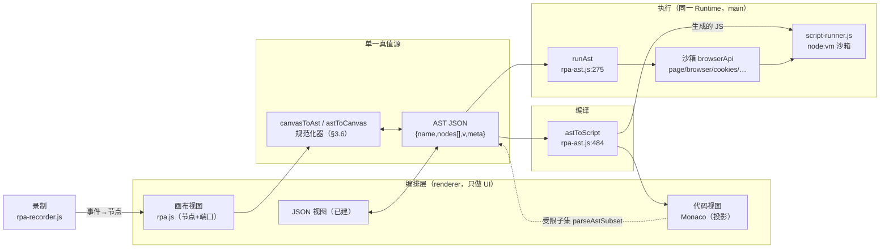

# 15 · 可视化脚本环境（Visual Scripting Environment）

> 性质：研究交付件。**演进**既有 RPA builder，不另立系统。本文只定 **技术设计**（节点分类法 / AST / 代码生成 / 调试接线）；**观感与交互（布局、拖拽手感、配色、动效、移动端）一律委派 doc 13（交互与视觉设计）**，本文仅给结构约束并交叉引用。
> 口径：每节区分「现状（as-built）」与「目标（target）」。现状证据带精确 `file:line`，未读码不写。
> 上游：[00-executive-summary.md](./00-executive-summary.md)、[04-automation-technology-selection.md](./04-automation-technology-selection.md)（ADR-5：可视化 = RPA→AST 同一运行时）、[05-system-architecture.md](./05-system-architecture.md)、[06-script-sdk-specification.md](./06-script-sdk-specification.md)。
> 现状语料：`../automation/rpa.md`（规格真值）、`automation/runtime/rpa-ast.js`、`automation/runtime/rpa-recorder.js`、`automation/runtime/script-templates.js`、`Client/renderer/automation-panel/rpa/{rpa.html,rpa.js,rpa.css}`、`automation/automation.d.ts`。
> 兄弟交付件：**doc 13**（交互与视觉设计）、**doc 14**（外部 SDK / 生态）。本文与 06/12/14 共享同一节点命名契约：**节点 = 对注入命名空间的 API 调用封装**。

---

## 1. 设计目标与边界

| # | 目标 | 说明 | 现状锚点 |
|---|---|---|---|
| G1 | **可视化与代码同源** | 单一真相源 = **AST**（`{name,nodes[]}` JSON）。画布视图与代码视图都是 AST 的投影；不存在「画布模型」与「代码模型」两套真值。 | `rpa-ast.js:40-45` `normalizeAst` 接受 `{nodes}`/`nodes[]`/JSON 串 |
| G2 | **复用现有 AST 与录制** | 复用 `rpa-ast.js`（26 节点、校验、执行、`astToScript`）与 `rpa-recorder.js`（选择器生成、事件→节点）；**不引第二运行时**。 | `rpa-ast.js:275-473` `runAst`；`rpa-recorder.js:72-240` |
| G3 | **不引第二运行时** | 画布产物仍走 `runAst` → `script-runner` 的 `browserApi`（1:1 映射）；`astToScript` 产物走同一 `node:vm`（**Electron 内嵌，无外部 node/python**，见 [16](./16-zero-runtime-distribution-constraints.md)）。 | `rpa-ast.js:1` 注释；`05` §4「可选可视化编排」行 |
| G4 | **双人群** | 非程序员：拖节点 + 表单 + 录制；程序员：JSON 视图（已建）+ 代码视图（新增）+ 类型提示（`automation.d.ts`）。 | `rpa.js:736-788` JSON 视图；`automation.d.ts:1-3` |
| G5 | **能力域全覆盖** | 节点按注入命名空间成域：`browser/page/context/cookies/storage/network/download/upload/dialog/params/profiles/console/step`（06 §2）。 | `automation.d.ts:426-448` 15 全局 |
| G6 | **可演进而非重写** | 现 26 节点保留兼容；新增节点走注册表扩展，旧 AST 不改写。 | `rpa-ast.js:18-30` |

**边界（非目标）**：

| 非目标 | 理由 |
|---|---|
| 不实现 JS→AST 全量反向解析 | `rpa.md` §7.2 已判 YAGNI；本文只定义**受限子集**的可解析边界（§4）。 |
| 不自带调度器 | RPA 流程作为 Script 资产被 Task 引用（`rpa.md` §1 铁律 4）。 |
| 不做自由画布（任意坐标 + 任意连线的 DAG 编辑器） | 会诱出与嵌套列表 AST 不等价的语义；控制流用**结构化端口**（§3.2），不是自由连线。 |
| 不做观感/交互细节 | 委派 doc 13。 |

---

## 2. 节点分类法（Node Taxonomy）

### 2.1 端口与出口模型

现状 AST 是**有序嵌套列表**（`rpa-ast.js:32` `CHILD_LISTS = ['then','else','body','catchBody']`），无端口概念。目标画布引入端口，但端口**只是视图**，编译回嵌套列表（§3.2）。端口四型：

| 端口 | 记号 | 语义 | 编译结果 |
|---|---|---|---|
| 控制入 | `in` | 上一节点/容器的接续 | 列表中的顺序位置 |
| 控制出·成功（**green**） | `ok` | 节点成功后走这里 | 下一兄弟节点（默认隐式） |
| 控制出·失败（**red**） | `err` | 节点抛错时走这里 | 物化 `try{…}catch{}` 包裹（§3.2） |
| 数据入/出 | `din/dout` | 参数引用与结果绑定 | `value/valueFrom/var/outVar` 字段 |

**green/red 双出口规则**（每个可执行节点都有）：

1. **red 未接线**：错误向上冒泡到最近的祖先 `try` 容器，或到流程终态 `FAILED`（现状行为）。
2. **red 已接线**：编译为 `try { <本节点 + 后续 green 链> } catch(<autoVar>) { <red 链> }`——**直接复用现有 `try` 节点语义**（`rpa-ast.js:445-453`），零新增执行器逻辑。
3. **green 恒有**（默认指向下一兄弟）；`end`/`throw`/`return` 节点无 green。

> 设计要点：green/red 不是第二套控制流引擎，而是 `try` 的**可视化糖**。这是「无第二运行时」在节点层的关键落点。

### 2.2 能力域节点清单

图例：**状态** ✅已建（`rpa-ast.js` 26 节点内）｜➕新增（纯 AST 字段 + 执行器分支，不改 SDK）｜⚠️需 SDK 扩展（`automation.d.ts` 无此 API）｜🔶目标（依赖 doc 14/其他阶段）。
**出口** 列写 `green/red` 表示双出口；`green` 表示仅成功出口。

#### A. 结构（structure）

| type | 语义 | 输入 | 输出 | API | 出口 | 状态 |
|---|---|---|---|---|---|---|
| `start` | 流程入口（唯一） | — | — | — | green | ✅（自动注入） |
| `end` | 流程出口（唯一） | `value?`（返回值） | — | script `return` | — | ✅（自动注入） |

#### B. 导航（navigation，ns `browser`）

| type | 语义 | 输入端口 | 输出端口 | API 调用 | 出口 | 状态 |
|---|---|---|---|---|---|---|
| `goto` | 主导航 | `url`,`waitUntil?` | — | `browser.goto(url,{waitUntil})` | green/red | ✅ |
| `back` | 后退 | `waitUntil?` | — | `browser.back` | green/red | ➕ |
| `forward` | 前进 | `waitUntil?` | — | `browser.forward` | green/red | ➕ |
| `reload` | 重载 | `waitUntil?` | — | `browser.reload` | green/red | ➕ |
| `closeWindow` | 关当前会话窗口（不销毁 ProfileContext） | — | — | `browser.close` | green/red | ➕ |
| `scroll` | 页内滚动 | `selector?`,`dy?`,`toEnd?` | — | `page.evaluate(scrollExpr)` | green/red | ✅ |
| `getCurrentUrl` | 取当前 URL | — | `outVar` | `browser.getCurrentUrl` | green/red | ➕ |
| `getTitle` | 取标题 | — | `outVar` | `browser.getTitle` | green/red | ➕ |

#### C. 定位/操作（locate/act，ns `page`）

| type | 语义 | 输入 | 输出 | API | 出口 | 状态 |
|---|---|---|---|---|---|---|
| `click` | 点击 | `selector`,`selectorType?` | — | `page.click` | green/red | ✅ |
| `clickText` | 按可见文本点击 | `text`,`selector?` | — | `page.click('text='+t)` | green/red | ✅ |
| `clickRole` | 按 role/name 点击 | `role`,`name?` | — | `page.click([role=…])` | green/red | ✅ |
| `fill` | 整框赋值 | `selector`,`value` | — | `page.fill` | green/red | ✅ |
| `type` | 逐键输入 | `selector`,`text`,`delay?` | — | `page.type` | green/red | ✅ |
| `press` | 按键 | `selector?`,`key` | — | `page.press` | green/red | ✅ |
| `select` | 下拉选值 | `selector`,`value` | — | `page.select`/`selectOption` | green/red | ✅ |
| `readText` | 读文本 | `selector` | `outVar` | `page.evaluate(innerText)` | green/red | ✅ |
| `readAttr` | 读属性 | `selector`,`name` | `outVar` | `page.getAttribute` | green/red | ✅ |
| `hover` | 悬停 | `selector` | — | `page.hover` | green/red | ⚠️（d.ts 无 `hover`） |
| `check` / `uncheck` | 勾选/取消 | `selector` | — | `page.check/uncheck` | green/red | ⚠️ |
| `readState` | 读可见性/包围盒 | `selector` | `outVar` | `page.locator(s).visible/boundingBox`（`automation.d.ts:148-157`） | green/red | ➕（Locator 已有） |

#### D. 等待（wait，ns `page.wait`）

| type | `for` 值 | 输入 | API | 出口 | 状态 |
|---|---|---|---|---|---|
| `wait` | `selector` | `selector`,`visible?` | `page.waitForSelector` | green/red | ✅ |
| `wait` | `text` | `selector`,`text` | `page.waitForText` | green/red | ✅ |
| `wait` | `url` | `url` | `page.waitForURL` | green/red | ✅ |
| `wait` | `timeout` | `ms`（纯延迟逃逸口，>1000ms 打 warning） | `delay(ms)` | green/red | ✅ |
| `wait` | `navigation` | `timeout?` | `page.waitForNavigation` | green/red | ➕（扩 `WAIT_KINDS`） |
| `wait` | `networkIdle` | `idleMs?`,`timeout?` | `page.waitForNetworkIdle` | green/red | ➕ |
| `wait` | `response` | `url`,`timeout?` | `page.waitForResponse` | green/red | ➕ |
| `wait` | `request` | `url`,`timeout?` | `page.waitForRequest` | green/red | ➕ |
| `wait` | `function` | `fn`,`args?` | `page.waitForFunction` | green/red | ➕ |

> 现状 `WAIT_KINDS`（`rpa-ast.js:36`）仅放行 `selector/text/url/timeout`；上表后 5 行对应 06 §3.2 `WaitSpec` 联合（`automation.d.ts:24-32`），是**纯 AST+执行器扩展**（不新增 SDK 方法）。

#### E. 数据/变量（data/vars）

| type | 语义 | 输入 | 输出 | API/编译 | 出口 | 状态 |
|---|---|---|---|---|---|---|
| `setVar` | 变量赋值（字面量 / `param.x` / `var.x`） | `name`,`value`\|`valueFromParam`\|`valueFromVar` | — | 写 `vars` Map | green/red | ✅ |
| `readText`/`readAttr` | 见 §C | | `outVar` | 写 `vars` | green/red | ✅ |
| `execJs` | 受限页内求值（超时+截断脱敏） | `expression` | `outVar?` | `page.evaluate` | green/red | ✅ |
| `log` | 执行日志 | `msg`\|`valueFromVar`,`level?` | — | `console.*` | green/red | ✅ |
| `step` | 标记当前步骤（协作式中断点） | `name` | — | `step(name)`（`automation.d.ts:448`） | green/red | ➕ |
| `return` | 提前返回结果 | `value`\|`valueFromVar` | — | `return` | — | ➕ |
| `template` | 字符串拼接/模板（**无 eval**） | `parts[]`（字面量/引用混合） | `outVar` | 受限拼接 | green/red | ➕ |

> `template` 用结构化片段数组替代字符串拼 JS，守住「AST 是数据不是代码」（`rpa.md` §1 铁律 2）。

#### F. 控制流（control）

| type | 语义 | 输入/子槽 | 出口 | 状态 |
|---|---|---|---|---|
| `if` | 条件分支 | `cond{left,op,right}`,`then[]`,`else[]` | green/red | ✅ |
| `loop` | 迭代 | `mode:'count'\|'while'\|'foreach'` + `times`/`cond`/`forEach`,`body[]` | green/red | ✅（`mode` 为画布糖，编译为 `times`/`forEach`） |
| `try` | 异常捕获 | `body[]`,`catchName`（画布 `catchVar`） | green/red | ✅ |
| `throw` | 抛错 | `message`\|`valueFromVar` | — | ✅ |
| `label` / `gotoLabel` | 跳转锚点/跳转 | `name`/`label` | green/red | ✅（`astToScript` 不线性化，见 §4） |
| `break` / `continue` | 跳出/继续当前 loop | `label?`（目标循环） | — | ➕（需执行器支持，见下） |
| `call` | 调用子流程/函数 | `ref`,`args{...}` | `outVar?` | 🔶（依赖 doc 14 子流程契约） |
| `return` | 见 §E | | — | ➕ |

> `break`/`continue`：现状 `execList`（`rpa-ast.js:293-315`）用 `halted`/`jump` 两信号。新增需在 `loop` 帧内引入 `breakSignal`/`continueSignal`（局部化，不改 `try` 语义）。**标注为新增执行器分支，非第二引擎。**

#### G. 存储（storage，ns `cookies`/`storage`）

| type | 语义 | 输入 | 输出 | API | 状态 |
|---|---|---|---|---|---|
| `cookieGet` | 读 cookie | `filter?` | `outVar` | `cookies.get` | ➕ |
| `cookieSet` | 写 cookie | `cookies[]` | — | `cookies.set` | ➕ |
| `cookieDelete` | 删 cookie | `filter` | — | `cookies.delete` | ➕ |
| `cookieClear` | 清当前 partition cookie | — | — | `cookies.clear` | ➕ |
| `storageGet` | 读分区存储 | `area:'local'\|'session'`,`key?` | `outVar` | `storage.local/session.get` | ➕ |
| `storageSet` | 写分区存储 | `area`,`items` | — | `storage.local/session.set` | ➕ |

#### H. 网络（network，ns `network`）

| type | 语义 | 输入 | 输出 | API | 状态 |
|---|---|---|---|---|---|
| `waitRequest` | 等请求 | `urlPattern`,`timeout?` | `outVar` | `network.waitForRequest` | ➕ |
| `waitResponse` | 等响应 | `urlPattern`,`timeout?` | `outVar` | `network.waitForResponse` | ➕ |
| `intercept` | 路由钩子（容器） | `pattern`,`times?` + 子槽 `handler[]`（`continue`/`fulfill`/`abort`） | — | `network.intercept` | 🔶（as-built 仅 `recent`，见 06 §7.2） |

> `intercept` 子动作为三型终端节点：`routeContinue` / `routeFulfill{body,status,headers}` / `routeAbort`。as-built `intercept` 未实装（06 §7.2），标 🔶。

#### I. 文件（file，ns `upload`/`download`/`browser`）

| type | 语义 | 输入 | 输出 | API | 状态 |
|---|---|---|---|---|---|
| `upload` | 上传文件 | `selector`,`files[]`（围栏内） | — | `upload.setFiles` | ✅ |
| `downloadWait` | 等下载 | `pattern?`,`timeout?` | `outVar` | `download.wait` | ✅ |
| `downloadSave` | 保存下载 | `target`(var),`destPath` | `outVar?` | `download.save` | ➕ |
| `screenshot` | 截图 | `fullPage?` | `outVar?` | `browser.screenshot`/`page.screenshot` | ✅ |

#### J. 多标签 / 多上下文（tabs/contexts，ns `browser`/`context`/`profiles`/`dialog`）

| type | 语义 | 输入 | 输出 | API | 状态 |
|---|---|---|---|---|---|
| `profileGet` | 取另一 profile 句柄（唯一跨 profile 路径） | `id` | `outVar`（ForeignProfileContext） | `profiles.get` | ➕ |
| `contextGet` | 取当前 profile 脱敏快照 | — | `outVar` | `context.get` | ➕ |
| `contextUpdate` | 更新 profile（走门禁，非直写） | `patch` | — | `context.update` | ➕ |
| `dialogAccept` | 接受对话框 | `promptText?` | — | `dialog.accept` | ➕ |
| `dialogDismiss` | 关闭对话框 | — | — | `dialog.dismiss` | ➕ |
| `tabNew` / `tabSwitch` / `tabClose` | 多标签页 | — | — | ⚠️ d.ts 无 `page.newPage`/tab API | ⚠️ |

> **多标签诚实声明**：现状 `BrowserSession` 一 ProfileContext 绑一窗口（05 §4）；SDK 无 tab 管理方法（`automation.d.ts:92-102` 仅 `close`）。`tab*` 节点标 ⚠️**需 SDK 扩展**；当前「多上下文」的**可达路径是 `profileGet`**（06 示例 2）。doc 13 不应把未实现的 tab 画成可用。

#### K. 任务 / 参数（task/params，ns `params`/`step`）

| type | 语义 | 输入 | 输出 | 映射 | 状态 |
|---|---|---|---|---|---|
| 参数引用（非节点） | 引用脚本参数 | `param.<name>` | — | `params[name]`（`rpa-ast.js:236`） | ✅（`setVar.valueFromParam`、`valueFrom`） |
| `step` | 步骤标记 | `name` | — | `step(name)` | ➕（见 §E） |
| 调度节点 | — | — | — | **无**：RPA 不自带调度器 | 明确缺席 |

### 2.3 状态口径与计数

| 口径 | 数 |
|---|---|
| `rpa-ast.js` 现有节点（`NODE_TYPES`，`rpa-ast.js:18-30`） | **26** |
| 画布可编辑节点（`rpa.js:55-132` `TYPES`，不含 `start/end` 自动注入） | **24** |
| 本文新增（➕，纯 AST/执行器） | 24 |
| 需 SDK 扩展（⚠️） | 4（`hover`/`check`/`uncheck`/`tab*` 组） |
| 目标/依赖他件（🔶） | 3（`call`、`intercept`、子流程 return 语义） |

> 计数以 `rpa-ast.js:18-30` 与 `rpa.js:55-132` 为准；新增项须同步扩这两处 + 校验器 + 执行器 + `astToScript`（§3.5）。

---

## 3. AST 设计

### 3.1 节点 schema

**根**：`{ name: string, nodes: RpaNode[], v?: number, meta?: object }`。现状 `normalizeAst` 接受 `{nodes}`（`rpa-ast.js:40-45`）；`v`/`meta` 为**向后兼容的可选扩展**（旧 AST 无 `v` 视为 `v:1`）。

| 字段 | 类型 | 必填 | 语义 |
|---|---|---|---|
| `id` | string | 画布必填 | 稳定短 id（`rpa.js:157` `uid()`）；AST 执行**不依赖** id，供画布选中/断点/错误定位 |
| `type` | string | ✅ | 节点类型（须在注册表内） |
| `typeVersion?` | number | — | 节点 schema 版本（§8） |
| `selector`/`selectorType?`/`quality?` | string/string/number | 按类型 | 定位器 + 形态档（`rpa-recorder.js:72-109`） |
| `outVar?` | string | 按类型 | 结果绑定变量名（`OUT_VAR_TYPES`，`rpa-ast.js:38`） |
| `value`/`valueFrom`/`valueFromVar`/`valueFromParam` | — | 按类型 | 值来源（`rpa-ast.js:232-241`） |
| `cond?` | `{left,op,right}` | `if`/`loop.while` | 结构化条件（**无 eval**） |
| `then/else/body/catchBody` | RpaNode[] | 容器 | 子列表（`CHILD_LISTS`，`rpa-ast.js:32`） |
| `err`（**新增**） | RpaNode[] | — | red 出口子列表；编译为 `try` 的 `catchBody`（§3.2） |

**校验**：`validateAst`（`rpa-ast.js:56-175`）已覆盖 type 合法 / 必填字段 / 嵌套≤8 / 节点≤5000 / 悬空 label / cond op 枚举 / `times`≤10000 / 标识符合法。新增节点须**扩 `NODE_TYPES` 与对应校验分支**，不改既有规则。

### 3.2 连线/端口模型 → 嵌套列表编译

画布是**结构化端口图**（非自由 DAG）。编译为 `nodes[]` 嵌套列表的规则：

| 画布形态 | 编译产物 |
|---|---|
| 同层 green 顺序 | 列表顺序（隐式，无需显式 green 边） |
| 节点 `err` 子列表非空 | `try { <本节点 + 后续 green 链> } catch(autoVar) { <err 链> }`（复用 `try`） |
| 节点 `err` 为空 | 错误冒泡（现状） |
| 容器（`if`/`loop`/`try`） | `then`/`else`/`body`/`catchBody` 子列表 |
| 数据出 `dout` → 数据入 `din` | `outVar` 字段 + 下游 `valueFromVar`（不产生显式边） |
| 数据入直连 `params`/`vars` | `valueFromParam` / `valueFromVar` |

**编译示例**（画布：`goto` red→`log`）：

```
画布: goto(red→log("导航失败"))
AST:  { type:'try', catchName:'__err_goto', body:[ {type:'goto',url:...} ],
        catchBody:[ {type:'log', msg:'导航失败'} ] }
```

**执行不变式**：编译产物只含现有节点类型（`try`/`log`/`goto`），`runAst` 无需新逻辑——**green/red 是编译期糖，不是运行时引擎**。

### 3.3 变量与作用域

| 项 | 现状 | 目标 |
|---|---|---|
| 变量存储 | 单一 `Map`（`rpa-ast.js:285` `vars`），全流程共享 | 保留；新增**作用域元数据**仅供画布/调试显示（不改变扁平语义） |
| 赋值 | `setVar` / `outVar`（`readText/readAttr/screenshot/execJs`，`rpa-ast.js:38`） | 同 |
| 引用 | `refValue`（`{var}/{param}/{const}`，`rpa-ast.js:208-214`）；`valueFrom` 前缀 `param.`/`var.`（`:232-241`） | 同；画布数据端口编译到这两条路径 |
| loop 绑定 | `foreach` 绑定 `x over y`（`FOREACH_RE`，`rpa-ast.js:35`） | 同；画布 `loop(mode=foreach)` 编译为 `forEach:'x over y'` |
| catch 绑定 | `catchName`（`:450`） | 同；画布 `catchVar` 规范化到 `catchName`（§3.6） |

### 3.4 序列化格式

| 场景 | 格式 | 现状 |
|---|---|---|
| 画布/存储/传输 | `{name,nodes[]}` JSON | ✅ `rpa.js` 全程 JSON；`script-store` 设计列 `ast_json`（`database.md:66,72`） |
| 执行入口 | `runAst(astJson, sandbox)` | ✅ `rpa-ast.js:275` |
| 代码生成 | `astToScript(astJson)` → `{code,metadata}` | ✅ `rpa-ast.js:484-679` |
| 导入导出 | `fp-script` 包 `{format,v,script,version,code}` | ✅ `script-store.js`（06 §8） |

> **建议扩展（目标）**：`v`（AST 版本）与 `nodeSchemaVersion` 写入根 `meta`，供 §8 版本化。

### 3.5 与 `rpa-ast.js` 现有 26 节点的映射与扩展点

**新增一个节点需触碰的 5 处**（现状散落，见 §8 收敛为注册表）：

| # | 位置 | 作用 |
|---|---|---|
| 1 | `NODE_TYPES`（`rpa-ast.js:18-30`） | 白名单 |
| 2 | `validateAst` 分支（`:56-175`） | 必填字段校验 |
| 3 | `runAst` `execNode` switch（`:317-465`） | 执行语义 |
| 4 | `astToScript` `gen` switch（`:517-667`） | 代码生成 |
| 5 | `rpa.js` `TYPES`（`:55-132`）+ `makeNode`（`:199-217`） | 画布目录与默认值 |

**现有 26 节点 → SDK 映射**（`runAst` 真值）：

| 节点 | SDK/编译 | 锚点 |
|---|---|---|
| `goto` | `browser.goto` | `:324-326` |
| `click/clickText/clickRole` | `page.click`（含 `text=`/`xpath=` 前缀、role 选择器） | `:327-343` |
| `fill/type/press/select` | `page.fill/type/press/select` | `:344-358` |
| `wait` | `page.waitForSelector/Text/URL` 或 `delay` | `:359-364` |
| `readText/readAttr` | `page.evaluate` / `page.getAttribute` | `:365-378` |
| `scroll` | `page.evaluate(scrollExpr)` | `:379-381` |
| `upload` | `page.setInputFiles` / `sandbox.upload.setFiles` | `:382-386` |
| `downloadWait` | `sandbox.download.wait` | `:387-390` |
| `screenshot` | `sandbox.screenshot`/`page.screenshot` | `:391-397` |
| `execJs` | `page.evaluate` | `:398-402` |
| `if/loop/setVar` | 解释执行 | `:403-436` |
| `label/gotoLabel` | 跳转表 | `:437-444` |
| `try/throw/log` | 异常/日志 | `:445-461` |

**扩展点总结**：`rpa-ast.js` 的沙箱契约 `{page,browser,params,delay,log,screenshot,upload,download}`（`:267-274` 注释）是 SDK 子集。新增命名空间（`cookies/storage/network/dialog/profiles/context`）须**扩沙箱注入**（宿主侧在 `runAst` 调用点传更多句柄），执行分支仍只调注入对象——**不触碰 `runAst` 的调度骨架**。

### 3.6 画布视图模型 ↔ 规范 AST 的字段规范化表（真实 delta）

**现状缺陷（实测）**：画布 `TYPES`（`rpa.js:55-132`）与 `rpa-ast.js` 的字段名**不完全一致**，且 `normalizeRecorded`（`rpa.js:830-846`）只映射了 `scroll.y→dy` 与 `wait.ms→timeout` 两处。若把画布 `flow` 直接喂 `runAst`，多处会读到 `undefined`。**这是必须在编译层修掉的真 delta**：

| 画布字段（`rpa.js`） | AST 字段（`rpa-ast.js`） | 节点 | 现状 | 处置 |
|---|---|---|---|---|
| `var` | `outVar` | `readText`/`readAttr`/`screenshot`/`downloadWait` | ❌未映射 | 编译器规范化 |
| `attr` | `name` | `readAttr` | ❌未映射 | 规范化 |
| `code` | `expression` | `execJs` | ❌未映射 | 规范化 |
| `message` | `msg` | `log` | ❌未映射 | 规范化 |
| `kind` | `for` | `wait` | ❌未映射 | 规范化 |
| `kind:visible/hidden/navigation/networkIdle/response/request/delay` | `for:selector/text/url/timeout` | `wait` | ❌值域不同 | 值映射（`visible→selector+visible`、`delay→timeout`，其余 §2.2-D 新增） |
| `mode/count/cond` | `times`/`forEach` | `loop` | ❌未映射 | 编译为 `times`/`forEach` |
| `catchVar` | `catchName` | `try` | ❌未映射 | 规范化 |
| `y` | `dy` | `scroll` | ✅已映射 | 保留 |
| `ms` | `timeout` | `wait` | ✅已映射 | 保留 |
| `pattern`/`var` | `pattern`/`outVar` | `downloadWait` | 部分 | `var→outVar` |
| `cond.op` 缺 `truthy` | `COND_OPS` 含 `truthy`（`rpa-ast.js:34`） | `if`/`loop` | 画布 `OPS`（`rpa.js:50`）无 `truthy` | 补齐 |
| `selectorType` | `selectorType` | `click` | 画布目录无该字段；录制器产出（`rpa-recorder.js:75`） | 补齐 |

> **结论**：必须引入一个显式的 **`canvasToAst(flow)` / `astToCanvas(ast)` 双向规范化器**，作为画布与 AST 的唯一桥。`normalizeRecorded` 升级为该规范化器的一部分。这是本文对现有实现最直接的修正项。

---

## 4. 代码生成与双向

### 4.1 AST → 代码（已建，扩展）

`astToScript`（`rpa-ast.js:484-679`）现状：

| AST 形态 | 生成 | 锚点 |
|---|---|---|
| 线性节点 | 逐行 SDK 调用 | `:517-667` |
| `if` | `if (genCond) {…} else {…}` | `:592-604` |
| `loop` | `for (…of …)` / `for (let __i=0;…)` | `:605-627` |
| `try/throw` | `try{}catch(e){}` / `throw` | `:642-660` |
| `label`/`gotoLabel` | **仅注释**（ceiling） | `:636-641` |
| 变量 | 局部 `const vars_ = {}`（`:670`） | |

**目标扩展**：为 §2.2 新增节点补 `gen` 分支；`metadata.ceiling`（`:676`）需随扩展更新。

### 4.2 代码 → AST 的可行边界

**总原则**（对齐 `rpa.md` §7.2）：**AST 是唯一真值源；代码视图是投影**。因此：

| 代码来源 | 可否回 AST | 说明 |
|---|---|---|
| `astToScript` 生成、且用户未改 | ✅ 天然一致 | 代码视图只读回显；无需解析 |
| `astToScript` 生成、用户在**受限子集内**编辑 | 🔶 可解析 | 新增 `parseAstSubset(code)`：识别 `await browser./page./cookies.…` 调用、`if/else`、`for-of`、`for(let i…)`、`try/catch`、`const vars_[...] =`、`log(...)`——即 `astToScript` 发射语法的**受限逆** |
| 任意手写 JS（模板 `script-templates.js`、Monaco 手写） | ❌ 单向 | 无法保证语义等价；标为 `runtime:'js'`，**失去画布编辑** |
| 含 `gotoLabel`（不线性化） | ❌ | `astToScript` 已拒绝（`:640`）；留在 AST 直执行 |

**保真与限制**：

1. **受限子集 parser** 只认 `astToScript` 的发射文法（白名单），任何不匹配 → 拒绝回 AST（不猜、不半解析）。
2. **round-trip 保真度**：`astToScript` 丢失 `id`/`quality`/注释与 label 结构（ceiling）；因此 **AST→code→AST 非恒等**——回解析只保证「语义等价的可视化近似」，`id` 重新生成。
3. **毕业（graduation）语义**：用户从画布切到代码并做**子集外**编辑时，脚本 `runtime` 由 `rpa_ast` → `js`，画布视图置灰（保留最近 AST 快照供 diff）。这是**单向门**，诚实告知（doc 13 负责提示交互）。

### 4.3 与 `script-templates.js` 的关系

模板（`script-templates.js:5-234`）是**手写 JS**，`runtime:'js'`，**不进入**画布 AST 路径。画布侧提供「从模板新建线性流程」的等价重述（`rpa.md` §7.2），但不解析模板源码。

---

## 5. 录制（复用 `rpa-recorder.js`）

### 5.1 链路（现状）

```
录制器（electron/recorder.js 注入监听）
  → raw 事件（click/input/change/keydown/scroll/navigate）
  → rpa-recorder.createRecorder().record(evt)   [rpa-recorder.js:130-227]
  → 节点（attach selector + quality）           [:143-150]
  → drain/stop → AST shell → builder Import     [rpa.js:830-846]
```

### 5.2 事件 → 节点映射（`rpa-recorder.js:170-199`）

| 事件 `kind` | 节点 | 附加字段 |
|---|---|---|
| `click` | `click` | `button?`；`clickCount≥2` 产两个 click（`:216-220`） |
| `input` | `fill` | `value`；300ms 窗口合并（`:156-166`，`DEBOUNCE_MS=300`） |
| `keydown` | `press` | `key` |
| `select` | `select` | `value` |
| `navigate` | `goto` | `url` |
| `scroll` | `scroll` | `y`、`toEnd?` |
| `change` | `upload` | `files[]`（仅 file input） |
| `wait-ms` | `wait` | `kind:'delay'`,`ms`（gap>2000ms 自动插入，`:202-214`） |

**无捕获源**（可重放/手工加，不自动录出）：`readText/readAttr/screenshot/downloadWait/execJs`（`rpa.md` §4 ceiling）。

### 5.3 选择器优先级与脆弱性提示

优先级（`rpa-recorder.js:6-15` `qualities`；`rpa.md` §3.1）：

```
data-testid(100) > id(90) > role(80) > name(70) > text(60) > css(40) > xpath(20) > coordinate(10)
```

| 档 | 形态 | 脆弱性 | 画布提示（doc 13 呈现） |
|---|---|---|---|
| 100 | `[data-testid]` | 最低 | 绿 |
| 90 | `#id` | 低 | 绿 |
| 80 | `[role][aria-label]` | 低 | 绿 |
| 70 | `[name]` | 中 | 蓝 |
| 60 | `text=` | 中（文案即失效） | 黄 |
| 40 | CSS（类名结构） | 中高 | 黄 |
| 20 | XPath（相对） | 高 | 橙 |
| 10 | `coordinate{x,y}` | 最高（分辨率/缩放） | 红 |

**反模式拒绝**：绝对 XPath（`/html/…`）、`div:nth-child` 深链、动态类名（哈希）**不作默认**（`rpa-recorder.js:99-102`；`rpa.md` §3.2）。唯一候选是脆弱形态时**不静默采纳**，标 `quality<20` 要求确认。

**发布闸**：`lintBlockingSleeps`（`rpa-recorder.js:112-127`）标记 `wait(kind='delay'|for='timeout')` 的固定睡眠，发布前须替换为智能等待（`rpa.md` §5）。

**可选唯一性探针**：`isUnique(selector)`（`rpa-recorder.js:73`）注入后 quality 反映**实测**唯一；未注入仅形态档位（诚实声明，`rpa.md` §4）。

---

## 6. 调试与运行

### 6.1 画布调试能力

| 能力 | 设计 | 现状基础 |
|---|---|---|
| 单步 | `runAst` 增可选 `onStep(nodeId, stepNo, vars)` 回调；宿主暂停 | `runAst` 现无钩子；`stepNo` 已存在（`rpa-ast.js:289`） |
| 断点 | `runAst` 增可选 `breakpoints:Set<nodeId>` + `await gate(nodeId)` 注入点 | 需新增（局部化） |
| 节点级日志 | `sandbox.log` 已把 `log` 节点写入 `logs`（`:456-461`）；扩展带 `nodeId` | ✅ `runAst` `logs[]` |
| 失败节点高亮 | `stepWrap` 已给错误打 `stepIndex`/`nodeType`（`:257-265`）；画布据 `nodeId` 高亮 | ✅ `stepWrap` |
| 变量查看 | `onStep` 传 `vars` 快照（Map→Object，`:470`） | 需新增回调 |
| 停止 | 复用 `script-runner` 协作式取消（`CancelledError`） | `script-runner.js` cancel 路径 |

> 断点/单步实现：因 `runAst` 是单线程 `async` 递归（`execList`，`:293-315`），在 `execNode` 前 `await gate(node.id)` 即可暂停，**不需要新执行引擎**。停止沿用 `step()` 协作式中断语义（`automation.d.ts:448`）。

### 6.2 与运行时的对接

| 层 | 现状 | 目标 |
|---|---|---|
| 执行 | `runAst(ast, sandbox)` | 增 `opts:{onStep,breakpoints,gate}` |
| 沙箱 | `{page,browser,params,delay,log,screenshot,upload,download}`（`:267-274`） | 扩注入 `cookies/storage/network/dialog/profiles/context`（§3.5） |
| 记录 | `ExecutionRecord{currentStep,logs,trace}`（`automation.d.ts:406-420`） | 画布消费 `logs`+`currentStep`+`trace` 做高亮 |
| 事件 | `automation:event` 推面板（05 §8.1） | 增 `automation:rpa:step`/`:break`（**同一 Service Layer，不新增专属执行器**） |
| 校验 | 画布本地 `localValidate`（`rpa.js:271-342`）+ 桥 `validate` | 统一走 `validateAst`（`rpa-ast.js:56`），renderer 校验仅兜底 |

> **铁律**：调试在 **main** 侧（renderer 只显示）。`rpa.js:26` 注释已声明「builder 是编辑器，不是执行器」。

---

## 7. 与代码编辑器并存

### 7.1 同一脚本「画布视图 / 代码视图」

```
         ┌─────────────── Script (script-store) ───────────────┐
         │  runtime: 'rpa_ast' | 'js'                          │
         │  ast_json (rpa_ast) | code (js)                     │
         └───────────────┬─────────────────────────────────────┘
                         │ 同一资产、同一版本
        ┌────────────────┼────────────────┐
   画布视图(rpa.js)   代码视图(Monaco)   JSON视图(rpa.js, 已建)
        └────────────────┴────────────────┘
                 ↕ canvasToAst / astToCanvas (规范化器, §3.6)
                        AST (唯一真值源)
                 ↓ astToScript              ↓ runAst
             代码投影 (Monaco 只读回显)   同一 Runtime 执行
```

| 项 | 设计 |
|---|---|
| 真值源 | AST（`runtime:'rpa_ast'`）；代码视图是 `astToScript` 投影 |
| 切换 | 同脚本内切「画布 / 代码 / JSON」三视图（JSON 视图已建，`rpa.js:736-788`） |
| 代码编辑 | 受限子集内 → `parseAstSubset` 回 AST；越界 → 毕业为 `js`（单向门，§4.2） |
| 冲突 | 同一脚本不可同时进入画布编辑与自由代码编辑（互斥锁，防双写） |

### 7.2 `automation.d.ts` 与节点目录共享类型来源

| 源 | 角色 | 现状 |
|---|---|---|
| `automation.d.ts` | **API 类型面 = 权限面**（06 §1） | ✅ 453 行 ambient 声明 |
| 节点目录（`TYPES`/注册表） | 每个节点的 `api` 路径（如 `page.click`） | 现为内联数据（`rpa.js:55-132`） |
| **单一来源** | 节点 manifest 声明 `api` 路径；CI 校验每个 `api` 在 `d.ts` 中存在 | 🔶 目标（§8） |

**规则**：`automation.d.ts` 仍是唯一 API 真值；节点目录**引用**它而非复制签名。新增节点若引用 `d.ts` 不存在的方法 → CI 失败（防止节点目录与 SDK 漂移）。

---

## 8. 节点目录的版本化与扩展

### 8.1 注册表（收敛 5 处散落）

将 §3.5 的 5 处收敛为**一份机器可读注册表**（如 `automation/runtime/node-registry.js` / `nodes.json`）：

```js
// 每项 = 节点定义（示意）
{
  type: 'cookieGet', group: '存储', api: 'cookies.get',
  inputs:  { filter: { kind: 'data', optional: true } },
  outputs: { outVar: { kind: 'var' } },
  exits:   { ok: true, err: true },
  fields:  [{ k: 'filter', type: 'json' }],
  validate(node){ /* 字段校验 */ },
  run(node, ctx){ /* 调 ctx.cookies.get */ },
  gen(node){ /* astToScript 片段 */ },
  canvas(node){ /* rpa.js TYPES 元数据 */ },
  since: 2,
}
```

`rpa-ast.js` / `rpa.js` / `astToScript` 从注册表**派生**白名单、校验、执行、生成、目录——新增节点 = **加一条注册项**（当前 5 处 → 1 处）。

### 8.2 版本化

| 版本号 | 载体 | 策略 |
|---|---|---|
| `astVersion`（根 `v`） | AST JSON 根 | 破坏性结构变更时 +1；旧版本自动升级（迁移函数） |
| `nodeSchemaVersion`（`typeVersion`） | 节点 | 单节点字段变更时 +1；旧字段保留读兼容 |
| 注册表版本 | `since` 字段 | 标注节点引入的注册表版本 |
| 弃用 | `deprecated:true` + `replacedBy` | 校验给 warning 不拒绝；`astToScript` 映射到替代节点 |

### 8.3 自定义节点 / 插件与 doc 14 共享 schema

| 项 | 设计 |
|---|---|
| 自定义节点 | 注册表可加载外部节点包（同 schema）；`api` 必须指向 `d.ts` 已有方法（权限面不变） |
| 插件信任 | 自定义节点执行码受**脚本隔离档**约束（06 §5：可信 `node:vm` / 不可信 `utilityProcess`）；节点不得绕过 capability 门禁 |
| 与 doc 14 共享 | 节点 schema（`type/inputs/outputs/exits/api`）与 doc 14 外部 SDK 的**同一 schema**；外部 SDK 生成的调用可编译为同型节点，反之亦然 |
| 与 doc 13 共享 | 注册表的 `group`/`label`/`glyph` 是 doc 13 布局的数据源（观感细节由 13 定） |

---

## 9. Mermaid

### 9.1 节点 → AST → 代码 → 运行时（数据流）



### 9.2 示例业务的 AST 结构（登录 + 失败重试）

业务：打开登录页 → 填账号密码 → 提交 → 等欢迎语；失败则记日志并抛错。

```mermaid
graph TD
  S[start] --> G[goto login]
  G --> W1[wait selector #username]
  W1 --> F1[fill #username = params.account]
  F1 --> F2[fill #password = params.password]
  F2 --> C[click button[type=submit]]
  C --> T["try (red 出口)"]
  T --> W2[wait text .welcome]
  W2 --> R[readText h1 -> outVar title]
  R --> E[end]
  T -.catch .-> L[log 'login failed']
  L --> X[throw message]
```

对应 JSON（节选，规范化后字段）：

```json
{
  "name": "login-retry",
  "v": 1,
  "nodes": [
    { "id": "n1", "type": "goto", "url": "https://example.com/login" },
    { "id": "n2", "type": "wait", "for": "selector", "selector": "#username", "visible": true },
    { "id": "n3", "type": "fill", "selector": "#username", "valueFromParam": "account" },
    { "id": "n4", "type": "fill", "selector": "#password", "valueFromParam": "password" },
    { "id": "n5", "type": "click", "selector": "button[type=submit]", "selectorType": "css" },
    { "id": "n6", "type": "try", "catchName": "__err",
      "body": [
        { "id": "n7", "type": "wait", "for": "text", "selector": ".welcome", "text": "Welcome" },
        { "id": "n8", "type": "readText", "selector": "h1", "outVar": "title" },
        { "id": "n9", "type": "end" }
      ],
      "catchBody": [
        { "id": "n10", "type": "log", "msg": "login failed", "level": "error" },
        { "id": "n11", "type": "throw", "message": "login did not complete" }
      ]
    }
  ]
}
```

---

## 10. 一致性

### 10.1 与 00–11 的一致性

| 本文主张 | 对齐文档 | 锚点 |
|---|---|---|
| AST 单一真值源、可视化与代码同源 | 04 ADR-5；05 §4「可选可视化编排」 | `04:82,107`；`05:83` |
| 不引第二运行时；green/red 是 `try` 糖 | 00 §2；04 §5；`rpa.md` §1 铁律 1 | `00:26`；`04:69-72` |
| 节点 = 注入命名空间的 API 封装 | 06 §2（15 全局） | `06:21-43` |
| 沙箱/隔离/错误类不变 | 06 §4/§5；08 | `06:198-243` |
| 录制复用、选择器优先级 | `rpa.md` §3/§4；`rpa-recorder.js` | `rpa.md:88-127` |
| 校验/上限（≤5000、≤8、≤10000） | `rpa.md` §2.2/§6.2 | `rpa-ast.js:4-7` |
| 代码生成 ceiling（label/gotoLabel） | `rpa.md` §7.1 | `rpa-ast.js:480-483,636-641` |
| 调试消费 `ExecutionRecord`/`automation:event` | 05 §8；06 §6 | `05:245-262` |
| 调度共用、RPA 无专属调度 | `rpa.md` §1 铁律 4；`task.md` §7 | `rpa.md:27` |
| 与 doc 13/14 边界 | 本文 §1、§8.3 | — |

**与兄弟交付件**：节点命名契约（`type`/字段/`api`）与 **06/12/14** 统一；观感交互归 **13**；外部 SDK schema 与 **14** 共用（§8.3）。

### 10.2 与 `docs/automation` 的关系（新增 / 修改 / 废弃）

| 类别 | 条目 | 说明 | 出处 |
|---|---|---|---|
| **新增** | 端口模型 + green/red 双出口 | 画布视图概念，编译为 `try`（§3.2） | 本文 |
| **新增** | `canvasToAst`/`astToCanvas` 规范化器 | 修 §3.6 字段 delta；`normalizeRecorded` 升级 | 本文 vs `rpa.js:830` |
| **新增** | 节点注册表（§8.1） | 收敛 5 处散落扩展点 | 本文 vs `rpa-ast.js`/`rpa.js` |
| **新增** | `parseAstSubset`（受限代码→AST） | 只认 `astToScript` 发射文法 | 本文 vs `rpa.md` §7.2 |
| **新增** | 画布调试（断点/单步/变量） | `runAst` 增 `onStep/breakpoints/gate` | 本文 vs `rpa-ast.js:275` |
| **新增** | 存储/网络/文件/对话框/多上下文节点域 | 扩沙箱注入 | 本文 §2.2-G..J vs `rpa-ast.js:267` |
| **修改** | `rpa.md` §7.2「不实现 JS→AST」 | 限定为**全量**不实现；**受限子集**可解析（§4.2） | 本文 vs `rpa.md:216-218` |
| **修改** | 画布节点目录字段名 | 规范化到 AST 字段（§3.6） | 本文 vs `rpa.js:55-132` |
| **修改** | `WAIT_KINDS` 值域 | 扩 `navigation/networkIdle/response/request/function` | 本文 vs `rpa-ast.js:36` |
| **修改** | 校验器/执行器/生成器 | 由注册表派生（§8.1） | 本文 |
| **废弃** | 画布自由坐标连线设想 | 结构化端口取代（§1 非目标） | 本文 |
| **废弃** | 「可视化是二等公民」表述 | AST 路径与代码路径同级（同 Runtime） | `rpa.md` §7.1「同一 Runtime，无二等公民」 |

---

## 11. 引用

- 规格真值：[../automation/rpa.md](../automation/rpa.md)（§2 节点全表 / §3 selector / §4 录制 / §5 等待 / §6 控制流 / §7 双向 / §9 builder UI）
- 实现：`automation/runtime/rpa-ast.js`、`automation/runtime/rpa-recorder.js`、`automation/runtime/script-templates.js`
- 画布：`Client/renderer/automation-panel/rpa/{rpa.html,rpa.js,rpa.css}`；嵌入接线 `Client/renderer/automation-panel/panel.js:1878-1885`
- 类型面：[../../automation/automation.d.ts](../../automation/automation.d.ts)（15 全局 / `WaitSpec` / `ExecutionRecord` / 错误类）
- 上游（本包）：[00-executive-summary.md](./00-executive-summary.md)、[04-automation-technology-selection.md](./04-automation-technology-selection.md)、[05-system-architecture.md](./05-system-architecture.md)、[06-script-sdk-specification.md](./06-script-sdk-specification.md)
- 数据/API：[07-data-model-and-api.md](./07-data-model-and-api.md)（`runtime`/`ast_json` 列）；安全/可靠性：[08-runtime-security-and-reliability.md](./08-runtime-security-and-reliability.md)；测试：[09-test-and-acceptance-plan.md](./09-test-and-acceptance-plan.md)；排期：[10-implementation-roadmap.md](./10-implementation-roadmap.md)（P8）
- 兄弟交付件：doc 13（交互与视觉设计）、doc 14（外部 SDK / 生态）
